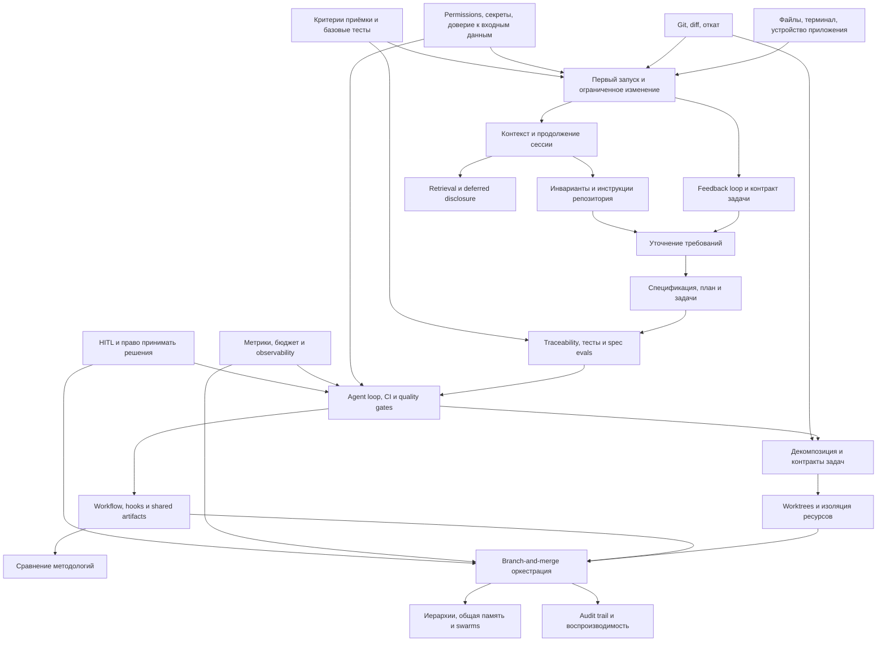
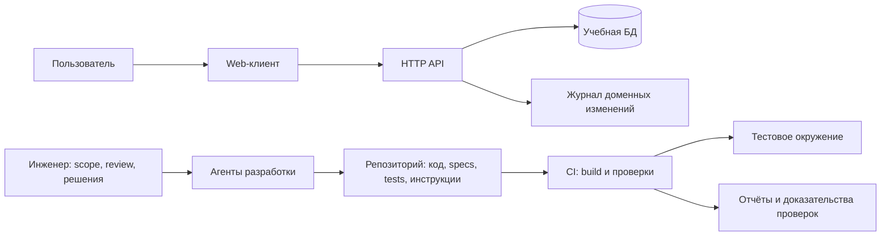

# AI-Assisted Engineering — архитектура образовательной программы

Дата анализа и проверки приведённых веб-источников: **2 ноября 2026 года**.

Статус: **предложение архитектуры курса**, подготовленное по `AGENTS.md`, `MASTER_PROMPT.md`, `CURRICULUM.md` и `PROGRESS.md`. Это анализ программы, а не отдельные уроки. Исходный curriculum сохранён без изменений; перестановки, дополнения и проект ниже являются рекомендациями. Ни один урок не объявляется завершённым.

## 1. Цель и общая оценка

Курс должен научить инженера управлять полным циклом AI-assisted разработки: формулировать задачу, предоставлять достаточный контекст, ограничивать действия агента, проверять изменения, сохранять решения и масштабировать процесс до нескольких агентов. Целевой результат — способность обосновать выбор workflow и подтвердить качество его результата, а не только получить работающий код.

Пять разделов образуют разумную траекторию:

1. Получить первый проверяемый результат с одним агентом.
2. Осознанно делегировать работу и организовать обратную связь.
3. Подготовить репозиторий, инструкции и контекст.
4. Связать требования, спецификации, реализацию и автоматическую проверку.
5. Организовать безопасную и измеримую работу нескольких агентов.

Сильные стороны плана — связь с Git и review, внимание к context engineering, спецификациям, воспроизводимости и стоимости координации. Основной недостаток — некоторые предпосылки появляются позже практики, которой они необходимы. Без ранних критериев приёмки, тестирования и границ доступа новичок может принять убедительный отчёт агента за доказательство корректности.

Другая проблема — неоднородность единиц программы: рядом стоят навыки, паттерны, продукты, методологии и авторские формулировки. Их следует объяснять на разных уровнях, сохраняя исходные названия. Номер паттерна или методологии не является номером урока.

В плане **68 исходных позиций**: 15 + 6 + 8 + 21 + 18 по разделам. Это число строк-тем, а не утверждённое количество уроков. Первая позиция «1.Основы работы с AI-агентами» может оказаться заголовком модуля; до уточнения она сохранена как самостоятельная вводная позиция.

## 2. Аудитория, prerequisites и входная диагностика

Основная аудитория — Middle, Senior, Staff и Tech Lead. Начинающему доступен раздел 1 при наличии подготовленного стартового репозитория и инструкций по окружению. Курс не должен предполагать, что AI заменит недостающие знания языка, HTTP или тестирования.

| Точка входа | Необходимые знания и условия | Проверка готовности | Если знаний недостаточно |
|---|---|---|---|
| Раздел 1 | Работа с компьютером; право установить инструменты; доступ к выбранному агенту; понимание платного использования | Открыть папку проекта, найти README, определить рабочую директорию | Короткий вводный практикум по файлам, редактору и терминалу внутри раздела 1 |
| Раздел 2 | Результаты раздела 1; базовое чтение кода на одном языке; diff, commit, запуск проверок | Объяснить небольшой diff и воспроизвести дефект | Закрепление TypeScript/Python и Git на стартовом проекте |
| Раздел 3 | Раздел 2; устройство клиент–серверного приложения; конфигурации и переменные окружения | Найти входные точки, зависимости, инструкции и команды проверки незнакомого репозитория | Подготовленный repository walkthrough |
| Раздел 4 | Раздел 3; HTTP/JSON, API-контракт, основы SQL и миграций; unit/integration-тесты, CI, ветки и PR | Перевести требование в позитивные и негативные acceptance criteria и запускаемые проверки | Мостик по требованиям, тестированию и CI до полного SDD workflow |
| Раздел 5 | Раздел 4; merge/conflict resolution; границы модулей; основы конкурентности и отказов | Разбить feature на независимые задачи, согласовать API и объяснить порядок интеграции | Упражнение на граф задач, конфликты и восстановление после сбоя |

Для опытного инженера допускается ускоренный вход после диагностического задания. Пропуск раздела не освобождает от его выходных критериев. Конкретный агент, платная подписка и облачный сервис не должны быть обязательными для всей программы: нужен локально воспроизводимый основной маршрут и явно обозначенные дополнительные ветки.

## 3. Матрица компетенций и выходные критерии

Обозначения: **В** — введение; **П** — применение; **У** — углубление. Пустая ячейка означает отсутствие отдельного фокуса, а не запрет использовать навык.

| Компетенция | Р1 | Р2 | Р3 | Р4 | Р5 |
|---|---|---|---|---|---|
| Работа с агентом и инструментами | В/П | У | П | У | У |
| Постановка задачи, делегирование и коммуникация | В | П | У | У | У |
| Git, diff, review и восстановление | В/П | П | П | У | У |
| Контекст, инструкции и durable artifacts | В | В | П/У | У | У |
| Требования, спецификации и traceability | В | В | В | П/У | У |
| Тестирование, evals и quality gates | В | П | П | П/У | У |
| Permissions, sandboxing и безопасность | В | П | У | У | У |
| Метрики, стоимость и observability | В | П | П | П | У |
| Декомпозиция, изоляция и оркестрация | В | В | В | П | П/У |
| Сравнение и адаптация методологий | — | — | В | П | У |

Раннее введение тестов, безопасности и метрик — предлагаемое усиление, а не утверждение, что эти темы уже раскрыты в исходном плане.

| Раздел | Измеримый результат обучения | Выходной артефакт и проверка |
|---|---|---|
| 1 | Запустить приложение, поручить ограниченное изменение, прочитать diff и проверить результат | Рабочая версия, commit, небольшой PR и отчёт с реально выполненными проверками; дефект воспроизведён и исправлен |
| 2 | Составить контракт задачи и выбрать способ взаимодействия с агентом | Две формулировки одной задачи, критерии приёмки и журнал обратной связи; сравнение результата и усилий review без обещания ускорения |
| 3 | Подготовить репозиторий к продолжению работы из новой сессии | Компактные инструкции, карта проекта, ограничения и handoff; новая сессия находит нужные файлы и запускает проверки |
| 4 | Провести изменение от согласованного требования до проверенного PR | Спецификация, план, задачи, тесты, CI и связи между ними; негативная проверка выявляет намеренно внесённый дефект |
| 5 | Обосновать и реализовать ограниченный мультиагентный workflow | Граф задач, изолированные ветки/окружения, интеграционный PR, журнал решений и измерений; продемонстрированы конфликт, отказ и восстановление |

## 4. Зависимости обучения

### 4.1. Карта ключевых концепций

Стрелка означает необходимую концептуальную предпосылку. Ранний обзор допустим до практического освоения; диаграмма не требует переименования или переноса тем между разделами.



### 4.2. Критические цепочки

- **Делегирование:** конкретный результат → критерии приёмки → доступные данные и инструменты → ограниченная задача → проверка → исправление. Выбор модели оптимизирует уже определённый процесс.
- **Контекст:** понимание видимости агента → отбор релевантных файлов → инструкции и приоритеты → progressive disclosure/retrieval → сохранение состояния → handoff с проверкой актуальности.
- **SDD:** выявление требований → разрешение неоднозначностей → инварианты и нефункциональные ограничения → спецификация → дизайн и задачи → независимые проверки → реализация → изменение спецификации при изменении требований.
- **Автоматизация:** надёжная ручная проверка → запускаемый локальный check → CI → ограниченный agent loop → hooks → переиспользуемый workflow. Автоматизация плохого критерия качества не делает его достоверным.
- **Мультиагентность:** последовательный baseline → граф зависимостей → контракты задач → разграничение владения → изоляция → интеграция → обработка отказов → сравнение совокупной стоимости и качества.

## 5. Пробелы и предлагаемые дополнения

«Пробел» здесь означает отсутствие явного места в перечне тем. Содержание будущих уроков ещё не написано, поэтому нельзя утверждать, что автор намеревался исключить эти понятия. Дополнения предлагается встроить в существующие темы.

| ID | Недостающее или недостаточно явное понятие | Куда встроить | Почему необходимо и как проверить |
|---|---|---|---|
| GAP-01 | Минимальная модель LLM и агента: вероятностная генерация, tool calling, состояние, отличие модели от harness | Р1.01, Р1.10–Р1.11; углубление Р4.03 | Читатель различает текстовое предположение агента и результат инструмента; объясняет, почему один запрос даёт разные реализации |
| GAP-02 | Безопасное выполнение: permissions, sandbox, секреты, redaction, границы сетевого доступа | Перед первым исполнением в Р1; Р3.03, Р4.11, Р5.06 | Подготовить карту разрешённых действий и секретов; агент не получает production credentials |
| GAP-03 | Prompt injection и недоверенные данные в репозитории, issue, документации и tool output | Р1.11, Р3.02, Р4.11 | На учебном примере отличить внешнюю инструкцию от данных и исключить несанкционированное действие; опора — [OWASP](https://genai.owasp.org/llmrisk/llm01-prompt-injection/) |
| GAP-04 | Базовая проверка: smoke, unit, integration, E2E, static analysis; тестовый oracle и негативные случаи | Р1.08, затем до Р4.05 | Воспроизвести баг до исправления и убедиться, что тест различает ошибочное и верное поведение |
| GAP-05 | Requirements engineering: stakeholders, scope/non-goals, acceptance criteria, NFR, ADR и изменение требований | Р2.06, Р3.06, Р4.01–Р4.05 | Связать требование с тестом; обнаружить конфликт требований; обновить связанные артефакты при изменении контракта |
| GAP-06 | Ограничения evals: общий источник ошибок автора и reviewer, false positives, test leakage, flaky tests | Р4.05, Р5.03 | Сопоставить self-review с независимой проверкой и разобрать пропущенный дефект |
| GAP-07 | Retrieval, поиск по репозиторию, бюджеты токенов, свежесть и происхождение контекста | Р3.05, Р4.13 | Собрать минимальный контекст с указанием источников и обнаружить устаревший документ; не требовать vector DB для любого проекта |
| GAP-08 | Контракты tools, схемы входа/выхода, ошибки, таймауты и MCP как возможный протокол интеграции | Р4.03, Р4.10–Р4.11 | Описать ограниченный интерфейс инструмента и проверить неверный ввод; MCP изучать отдельно от понятия plugin, по [спецификации](https://modelcontextprotocol.io/specification/) |
| GAP-09 | Bounded execution: stop conditions, retries, idempotency, cancellation, checkpoint/resume и бюджет | Р4.03, Р5.09–Р5.11 | Цикл останавливается при лимите или повторяющейся ошибке и продолжает работу без дублирования побочного эффекта |
| GAP-10 | Граф задач, границы владения, совместимость API, race conditions и consistency общей памяти | До Р5.08; Р5.09–Р5.11 | Две задачи не изменяют неявно один контракт; разбор намеренного конфликта и устаревшего handoff |
| GAP-11 | Изоляция runtime-ресурсов: порты, БД, fixtures, env, зависимости и секреты | Р5.08 | Параллельные задачи не используют общую изменяемую тестовую БД. Git worktree даёт отдельное рабочее дерево, но runtime-изоляцию нужно проектировать дополнительно: [Git](https://git-scm.com/docs/git-worktree) |
| GAP-12 | Observability и экономика: latency, tokens, стоимость, review/rework, traces, исходный baseline | Минимум Р1.02/Р1.10, измерения Р2, углубление Р5.02/Р5.14 | Сохранить время, затраты и качество для сопоставимых задач; отсутствующие данные обозначить как неизвестные. Для сигналов — [OpenTelemetry](https://opentelemetry.io/docs/concepts/observability-primer/) |
| GAP-13 | Brownfield, monorepo, characterization tests, миграции и совместимость | Р3.01, Р4.01, Р4.16–Р4.20 | Изменить существующий модуль без регрессии и обновить схему данных с планом восстановления |
| GAP-14 | Supply chain, версии tools/plugins, лицензии и политика данных | Р4.10, Р5.05, Р5.14 | Зафиксировать источник и версию расширения, проверить diff установки и правила обработки данных; не трактовать лицензирование как универсальную юридическую рекомендацию |
| GAP-15 | Выпуск и эксплуатация: staging, rollback, feature flags, инциденты и ответственность | Р4.07, Р5.06, Р5.12 | Проверить неуспешный выпуск в тестовой среде и процедуру восстановления; отдельно определить, кто разрешает выпуск |
| GAP-16 | Методика эксперимента: сопоставимые задачи, повторные прогоны, распределения, ограничения выборки | Р2.03, Р5.02 | Сравнить single-agent и multi-agent без изменения одновременно модели, задачи и критериев качества; не обобщать единичный успех на весь класс задач |

GAP-01–GAP-06 — минимально необходимые основания. GAP-07–GAP-11 обязательны до сложной автоматизации и параллельного исполнения. GAP-12–GAP-16 нужны для заявленного production-уровня и доказательной оценки результатов.

## 6. Повторы и способы их разведения

| Темы | Характер пересечения | Рекомендуемая граница |
|---|---|---|
| Р1.11–Р1.12, Р2.05, Р3.05, Р4.13 | Одна линия context engineering | Р1 — наблюдать видимость и потерю состояния; Р2 — различать prompt/context; Р3 — проектировать загрузку; Р4 — реализовать deferred disclosure и проверить эффективность |
| Р3.06 и Р4.04: Паттерн 3 | Явное повторное применение | Сначала уточнение инженерной задачи, затем проверка полноты и противоречий спецификации; сохранить номер паттерна 3 |
| Р3.08 и Р4.15: Методология 1 | Введение и повторная база сравнения | В Р3 зафиксировать рабочую модель; в Р4 использовать тот же пример и rubric, без повторного полного введения |
| Р3.03 и Р4.14 | Инварианты и ценностные ограничения | Р3 — технические инварианты; Р4 — преобразование принципов в наблюдаемые ограничения и точки человеческого решения; не обещать техническую гарантию из декларации ценностей |
| Р3.07 и Р4.21 | Два урока о сравнении методологий | Р3 — протокол чтения и проверки источников; Р4 — итоговая сравнительная работа на собранных данных |
| Р1.13, Р3.04, Р4.08–Р4.10 | Повторное использование артефактов | Развести сохранённый запрос, инструкции проекта, исполняемый workflow, обмен результатами и пакет распространения |
| Р1.14–Р1.15 и Р5.01/Р5.08–Р5.11 | Раннее делегирование и полноценная оркестрация | Р1 — последовательный handoff одной задачи; Р5 — граф задач, изоляция, координация и интеграция; облако не является синонимом multi-agent |
| Р2.03, Р4.05/Р4.07 и Р5.03/Р5.06 | Обратная связь и качество | Принцип feedback loop → реализация проверок → накопление verification debt → политика допуска изменений |
| Р4.09, Р5.05, Р5.10, Р5.14 | Общие и версионируемые артефакты | Формат обмена → история версий → согласованность общей памяти → воспроизводимый пакет доказательств |

Повтор не следует автоматически удалять: спиральное обучение полезно, если каждый возврат создаёт новый артефакт или требует более сильной проверки. Повторное определение без нового результата нужно заменять ссылкой на предыдущий материал.

## 7. Проблемы последовательности и рекомендуемый маршрут

### 7.1. Что требует изменения порядка или раннего введения

| Текущее положение | Проблема | Предложение |
|---|---|---|
| Установка агента до файлов и терминала | Новичок не понимает рабочую директорию и результат команд | Р1.04 и Р1.05 изучить перед Р1.03; Р1.01 оставить обзором |
| Контекст подробно рассматривается после нескольких изменений | Непонятно, какие файлы и данные доступны агенту | Короткое введение в видимость и права дать до первого запуска; полный разбор Р1.11 оставить после опыта |
| Первый запуск до Git | Допустимо на чистом scaffold, опасно на существующем проекте без точки восстановления | До агентного редактирования сделать baseline; полный урок Git провести в Р1.07 |
| Выбор модели раньше осознанного feedback loop раздела 2 | Возникает риск объяснять все ошибки выбором модели | Р1.10 — базовые параметры и бюджет; системный выбор обосновывать после Р2.03 |
| Спецификация из последовательных файлов до уточнения спеки | Легко формализовать противоречивое требование | В Р4 изучить Р4.04 сразу после Р4.01 и до Р4.02 |
| Agent loops до полного контура проверок | Повторение действий не имеет надёжного условия успеха | Полную реализацию Р4.03 изучить после Р4.05 и Р4.07; понятие agent loop ввести раньше |
| Shared artifacts после reusable workflow | Не определены контракты между шагами | Р4.09 перед Р4.08; Р4.11 до упаковки инструментов и workflow |
| Сравнительная методика в конце Р4 | Продукты изучаются без общей шкалы | Взять rubric из Р3.07 перед кейсами; Р4.21 оставить итоговым синтезом |
| HITL после swarms | Права решения и остановки определяются после автономной работы | Р5.12 изучить до параллельного выполнения; базовый принцип ввести в Р1 |
| Audit trail в конце Р5 | Ранние эксперименты теряют доказательства и версии | Минимальный журнал с Р1; полноценный пакет Р5.14 до сравнительных кейсов Р5.15–Р5.18 |
| AOP после оркестрации | Непонятно, является ли это предпосылкой или отдельным подходом | Сначала установить смысл; если речь о cross-cutting policy, разбирать после hooks и gates, до swarms |

### 7.2. Предлагаемый порядок внутри разделов

Идентификаторы ниже ссылаются на полный реестр в разделе 8. Темы сохраняют принадлежность исходным разделам. Дополнительные мостики из раздела 5 встраиваются в соответствующие темы, а не объявляются новыми утверждёнными уроками.

- **Раздел 1:** Р1.01 → Р1.04 → Р1.05 → Р1.02 → Р1.03 → Р1.06 → Р1.07 → Р1.08 → Р1.09 → Р1.10 → Р1.11 → Р1.12 → Р1.13 → Р1.14 → Р1.15 (дополнительно). До Р1.03 обязательны краткие сведения о доступе, контексте, стоимости и точке восстановления; до Р1.08 — критерий приёмки и запуск базовой проверки.
- **Раздел 2:** Р2.01 → Р2.02 → Р2.03 → Р2.05 → Р2.06 → Р2.04. Делегирование в финале опирается на явный контракт задачи. Содержание «девяти уровней», «трёх режимов» и «закона» требует установления источника.
- **Раздел 3:** Р3.01 → Р3.02 → Р3.03 → Р3.05 → Р3.04 → Р3.06 → Р3.07 → Р3.08. Инструкции оформляются после отбора контекста и инвариантов. Перед Р3.08 нужен короткий мостик «требование, спецификация, критерий приёмки»; полный SDD остаётся в Р4.
- **Раздел 4:** Р4.01 → Р4.04 → Р4.02 → Р4.05 → Р4.07 → Р4.03 → Р4.06 → Р4.09 → Р4.11 → Р4.08 → Р4.10 → Р4.13 → Р4.14 → Р4.12 → Р4.15 → Р4.16 → Р4.17 → Р4.18 → Р4.19 → Р4.20 → Р4.21. CI начинается с существующего локального check; мета-подход обсуждается после конкретных реализаций и уточнения значения.
- **Раздел 5:** Р5.01 (обзор) → Р5.02 → Р5.03 → Р5.04 → Р5.12 → Р5.05 → Р5.06 → Р5.07 → Р5.13 → Р5.08 → Р5.09 → Р5.10 → Р5.11 → Р5.14 → Р5.15 → Р5.16 → Р5.17 → Р5.18. Перед Р5.08 добавить граф задач, контракты и изоляцию runtime; до Р5.13 установить значение AOP. Swarms изучаются как вариант с ограничениями, а не обязательная вершина зрелости.

Параллельное изучение возможно для независимых методологических кейсов после общей практики и rubric. Это рекомендация по устройству курса, а не требование выполнять текущую подготовку несколькими агентами.

## 8. Реестр всех исходных тем

ID вида `Р4.07` обозначает место темы в исходном разделе и остаётся стабильным при предложенной перестановке. Названия сохранены буквально. Зависимости — ближайшие существенные, транзитивные зависимости подразумеваются. Формулировки результатов являются проектом learning outcomes.

### Раздел 1 — 15 позиций

| ID | Исходное название | Зависимости / условие | Планируемый результат |
|---|---|---|---|
| Р1.01 | 1.Основы работы с AI-агентами | Входная диагностика | Различить модель, агент, инструмент и проверку; определить границы ответственности |
| Р1.02 | Какой инструмент выбрать и за что платить? | Р1.01; базовая навигация | Составить критерии выбора с учётом доступа, данных и бюджета |
| Р1.03 | Установить агента и выполнить первый запуск | Р1.02, Р1.04–Р1.05; GAP-02 | Запустить агент в правильной папке и проверить конфигурацию |
| Р1.04 | Папка, файл, редактор и терминал | Начальные компьютерные навыки | Найти файл, прочитать команду и определить рабочую директорию |
| Р1.05 | Из чего состоит приложение: клиент, сервер, данные | Р1.04 | Проследить запрос от интерфейса до хранилища |
| Р1.06 | Запустить первое приложение и понять результат | Р1.03–Р1.05; baseline | Проверить клиент, API и сохранение данных; отличить ошибку окружения от дефекта |
| Р1.07 | Git: сохранить рабочую версию и увидеть изменения | Р1.04, Р1.06 | Создать commit, прочитать diff и восстановить учебное изменение |
| Р1.08 | Поручить изменение, получить проверку, исправить ошибку | Р1.07; GAP-04 | Выполнить небольшой change с критерием приёмки и доказательством исправления |
| Р1.09 | GitHub: разместить проект и подготовить изменение к проверке | Р1.07–Р1.08 | Подготовить ветку и PR с описанием и результатами проверки |
| Р1.10 | Как выбирать модель и глубину рассуждений | Р1.02, Р1.08 | Обосновать настройку для задачи и бюджета без универсального рейтинга |
| Р1.11 | Что агент видит: контекст и его объём | Р1.01, Р1.08 | Указать доступные данные и обнаружить недостаток контекста |
| Р1.12 | Длинная переписка, сжатие истории и продолжение работы | Р1.11 | Продолжить работу из проверенного summary с актуальными ссылками |
| Р1.13 | Сохранить удачный запрос в репозиторий | Р1.07, Р1.08, Р1.11 | Сохранить параметризуемый запрос и ограничения его применения |
| Р1.14 | Передать задачу другому агенту и получить проверку | Р1.08, Р1.12–Р1.13 | Выполнить последовательный handoff и проверить итог независимо от отчёта |
| Р1.15 | Передать задачу на выполнение в облако (дополнительно) | Р1.09, Р1.14; доступ и бюджет | Проверить окружение, данные, права и результат облачного исполнения |

### Раздел 2 — 6 позиций

| ID | Исходное название | Зависимости / условие | Планируемый результат |
|---|---|---|---|
| Р2.01 | Эволюция работы с AI: девять уровней | Выход Р1; уточнение источника модели | Оценить workflow по явным критериям и ограничениям классификации |
| Р2.02 | Три режима работы с AI | Р2.01; уточнение терминов | Выбрать режим взаимодействия для конкретной задачи |
| Р2.03 | Сначала цикл обратной связи, потом модель | Р1.08, Р2.02 | Построить измеримый feedback loop и локализовать причину неудачи |
| Р2.04 | Закон делегирования | Р2.03, Р2.06; уточнение формулировки | Определить, что можно делегировать и какой контроль требуется |
| Р2.05 | Prompt vs Context | Р1.11–Р1.12 | Разделить текст запроса, данные, инструкции и состояние окружения |
| Р2.06 | Контракт промпта: от 4 к 7 элементам | Р2.03, Р2.05; уточнение состава элементов | Составить проверяемый контракт задачи без избыточных ограничений |

### Раздел 3 — 8 позиций

| ID | Исходное название | Зависимости / условие | Планируемый результат |
|---|---|---|---|
| Р3.01 | AI Readiness: функция трёх переменных | Выход Р2; источник переменных | Провести аудит готовности репозитория по наблюдаемым признакам |
| Р3.02 | 4-слойная steering-архитектура (обзор) | Р3.01, Р2.05; источник модели | Описать области действия инструкций и конфликт между ними |
| Р3.03 | Паттерн 1. Инварианты | Р3.02; GAP-02 | Выделить неизменяемые ограничения и способ их проверки |
| Р3.04 | Паттерн 2. Two-pass AGENTS.md (живой артефакт) | Р3.03, Р3.05; смысл двух проходов | Создать компактные инструкции и проверить их на реальной задаче |
| Р3.05 | Context engineering и progressive disclosure | Р2.05, Р3.03 | Построить карту контекста с бюджетом и условиями загрузки |
| Р3.06 | Паттерн 3. Ask-before-writing (цикл уточняющих вопросов) | Р2.06, Р3.03–Р3.04 | Устранить значимые неоднозначности и зафиксировать допущения |
| Р3.07 | Как изучать методологии? | Р3.01, Р3.06 | Подготовить rubric, правила работы с источниками и воспроизводимый кейс |
| Р3.08 | Методология 1. Spec-anchored | Р3.06–Р3.07; мостик по спецификациям | Описать роль спецификации в рабочей модели и проверить сохранение связи с кодом |

### Раздел 4 — 21 позиция

| ID | Исходное название | Зависимости / условие | Планируемый результат |
|---|---|---|---|
| Р4.01 | SDD и три уровня зрелости спецификации | Р3.08; GAP-04–GAP-05 | Различить требование, спецификацию, дизайн и проверку; установить источник уровней |
| Р4.02 | Паттерн 4. Спецификации из X последовательных файлов (детерминированные стадии) | Р4.01, Р4.04 | Определить вход, выход и gate каждой стадии; объяснить пределы детерминизма |
| Р4.03 | Паттерн 5. Agent Loops / Harness Engineering | Р4.05, Р4.07; GAP-08–GAP-09 | Спроектировать ограниченный loop с инструментами, проверкой, остановкой и восстановлением |
| Р4.04 | Паттерн 3. Ask-before-writing на уровне спеки | Р3.06, Р4.01 | Найти противоречия и неопределённые acceptance criteria в спецификации |
| Р4.05 | Паттерн 6. Spec self/auto-evals (чек-лист + прогон агентом) | Р4.02; GAP-04–GAP-06 | Соединить checklist, независимые тесты и ограничения self-review |
| Р4.06 | Паттерн 7. Hooks: lifecycle vs git-style | Р4.03, Р4.07 | Различить события, области действия, ошибки и возможность обхода hooks |
| Р4.07 | Урок 11. CI/CD как loss function | Р1.09, Р4.05; основы CI | Запустить checks на PR; объяснить метафору и то, что CI не обучает веса модели |
| Р4.08 | Паттерн 8. Переиспользуемый workflow | Р4.03, Р4.09, Р4.11 | Описать входы, шаги, выходы, сбои и критерии успешного повторного запуска |
| Р4.09 | Паттерн 9. Shared artifacts | Р4.02, Р4.05 | Согласовать форматы, владельцев и версии передаваемых артефактов |
| Р4.10 | Паттерн 10. Plugins/Bundles | Р4.08, Р4.11; GAP-14 | Упаковать workflow с явными зависимостями, правами и процедурой обновления |
| Р4.11 | Паттерн 11. Narrow API surface | Р4.03; GAP-08 | Ограничить tool API, валидировать вход и обработать ошибку |
| Р4.12 | Паттерн 12. Мета-подход | Р4.08–Р4.10; определение термина | Предложить и проверить улучшение workflow на фиксированном кейсе |
| Р4.13 | Паттерн 13. Deferred context disclosure | Р3.05, Р4.09 | Реализовать отложенную загрузку и проверить свежесть, полноту и стоимость контекста |
| Р4.14 | Моральные принципы как инварианты | Р3.03, Р4.11 | Преобразовать принцип в ограничения, тесты и человеческие решения с явными пределами |
| Р4.15 | Методология 1. Spec-anchored как основа сравнения | Р3.08, Р4.05, Р4.08 | Зафиксировать baseline и единый кейс для последующих сравнений |
| Р4.16 | Методология 2. GitHub Spec Kit | Р4.15, Р3.07 | Воспроизвести кейс и проверить документированные артефакты и gates |
| Р4.17 | Методология 3. OpenSpec | Р4.15, Р3.07 | Выполнить тот же change и оценить сопровождение спецификаций |
| Р4.18 | Методология 4. Kiro (AWS) | Р4.15, Р3.07; доступ к продукту | Отделить метод работы со specs от возможностей и ограничений продукта |
| Р4.19 | Методология 5. specs.md | Р4.15, Р3.07; подтверждение проекта | Исследовать выбранную реализацию на общем кейсе, сохранив версию и происхождение |
| Р4.20 | Методология 6. superpowers | Р4.15, Р4.08; базовое понятие субагента | Оценить workflow и skills; сложную параллельную практику связать с Р5 |
| Р4.21 | Как читать и сравнивать методологии | Р4.15–Р4.20, Р3.07 | Представить evidence-based сравнение и решение для заданных ограничений |

### Раздел 5 — 18 позиций

| ID | Исходное название | Зависимости / условие | Планируемый результат |
|---|---|---|---|
| Р5.01 | Мультиагентный режим | Выход Р4 | Различить handoff, последовательную делегацию и параллельное выполнение |
| Р5.02 | Метрики и где настоящий bottleneck | Р2.03, Р4.07, Р5.01; GAP-12/GAP-16 | Измерить baseline, review, rework, latency и затраты без подмены качества скоростью |
| Р5.03 | Verification debt | Р4.05, Р5.02 | Выявить непроверенные допущения и составить план погашения долга проверки |
| Р5.04 | Soft skills — новые hard skills | Р2.04, Р3.06, Р5.03 | Согласовать ответственность, передать контекст и разрешить конфликт требований |
| Р5.05 | Паттерн 14. Version Every Thing (VET) | Р4.09–Р4.10; определение охвата VET | Зафиксировать версии спецификаций, tools, prompts и окружения без секретов |
| Р5.06 | Паттерн 15. Quality gates и blast-radius control | Р4.07, Р5.03, Р5.12 | Соотнести риск изменения с проверкой, правами и порядком допуска |
| Р5.07 | Паттерн 16. Архитектурные тесты | Р3.03, Р5.06; границы модулей | Автоматически обнаружить запрещённую зависимость или нарушение архитектурного инварианта |
| Р5.08 | Паттерн 17. Git worktrees / параллельные субагенты | Р5.05–Р5.07, Р5.12; GAP-10–GAP-11 | Выполнить независимые задачи в отдельных деревьях и runtime-ресурсах |
| Р5.09 | Паттерн 18. Branch-and-merge оркестрация | Р5.08; merge/conflicts | Согласовать порядок интеграции и повторные проверки после merge |
| Р5.10 | Паттерн 19. Иерархические команды агентов с общей памятью | Р5.09, Р4.09; GAP-10 | Определить роли, контракты handoff и правила обновления общей памяти |
| Р5.11 | Паттерн 20. Swarms и оркестрация | Р5.10, Р5.02; GAP-09 | Проверить ограниченный вариант orchestration и сравнить его с простым baseline |
| Р5.12 | Паттерн 21. Agent-Human separation of responsibilities (HITL) | Р5.01, Р5.04; ранние permissions | Определить владельца решения, точки review, эскалацию и остановку |
| Р5.13 | Паттерн 22. Aspect Oriented Programming (AOP) | Р4.06, Р5.06–Р5.07; уточнение смысла | Развести классический AOP и возможную рабочую модель сквозных агентных политик |
| Р5.14 | Паттерн 23. Reproducibility unit + audit trail | Р5.05, Р5.09, Р5.02; GAP-12 | Собрать пакет входов, версий, событий и результатов; объяснить пределы повторяемости |
| Р5.15 | Методология 7. Tessl | Р4.21, Р5.14; выбранный компонент и версия | Оценить конкретный компонент платформы по общей rubric |
| Р5.16 | Методология 8. BMAD-METHOD | Р4.21, Р5.10, Р5.14 | Проверить роли, артефакты и workflow на том же кейсе |
| Р5.17 | Методология 9. Augment Cosmos | Р4.21, Р5.11–Р5.14; доступ к продукту | Разобрать платформенную реализацию оркестрации и отделить заявления поставщика от измерений |
| Р5.18 | Методология 10. AI-DLC | Р4.21, Р5.12, Р5.14 | Сопоставить lifecycle, роли, артефакты и gates с предыдущими подходами |

## 9. Терминологические и исследовательские вопросы

До подготовки соответствующих уроков необходимо закрыть следующие вопросы. Они не блокируют архитектурный анализ, но ограничивают точность будущих определений.

| Группа | Что нужно установить | Правило подготовки |
|---|---|---|
| «Девять уровней», «три режима», «закон делегирования», «4 к 7 элементам» | Автор, исходная публикация, точный состав и применимость | При отсутствии источника описывать как рабочую модель курса; не представлять как установленный закон или универсальную maturity model |
| AI Readiness и 4-слойная steering-архитектура | Какие три переменные и четыре слоя имеются в виду | Не придумывать состав на основании названия; отдельно проверить реальные приоритеты инструкций выбранного агента |
| Two-pass AGENTS.md, Spec-anchored, «три уровня зрелости», «Мета-подход» | Точное определение и происхождение | Рабочие outcomes в реестре — предложения; официальность и авторство пока не установлены |
| Последовательные файлы и «детерминированные стадии» | Формат артефактов, gates, переходы и обработка возвратов | Различать детерминированный порядок процесса и недетерминированную генерацию; число файлов не гарантирует качество |
| «CI/CD как loss function» | Смысл педагогической метафоры | CI создаёт обратную связь и условия допуска; само выполнение pipeline не означает обучение параметров модели |
| VET и Reproducibility unit | Состав версионируемого пакета, исключения, внешние зависимости | Повторяемость процесса не обещает побитово одинаковый LLM-вывод; доступ к старой модели может быть недоступен |
| AOP | Классический Aspect Oriented Programming или особый агентный паттерн | Исходная расшифровка сохранена; hooks, middleware и policy checks не объявлять автоматически классическим AOP |
| specs.md | Какой проект подразумевается | Найден кандидат [fabriqaai/specs.md](https://github.com/fabriqaai/specs.md); до подтверждения не считать совпадение названия доказательством авторского замысла |
| Tessl и Augment Cosmos | Конкретный продукт, компонент, версия и доступный учебный сценарий | Сохранять исходный ярлык «методология», но объяснять, что предметом анализа может быть платформа; не сопоставлять целую платформу с одним паттерном как равные единицы |
| «Урок 11» и вводная «1.Основы…» | Это исходная нумерация урока и заголовок или отдельные темы? | Не исправлять молча; использовать стабильные ID реестра, не выводить количество уроков из номеров паттернов |

Предварительная проверка первоисточников подтвердила наличие репозиториев GitHub Spec Kit, OpenSpec, superpowers, specs.md и AI-DLC, документации Kiro/BMad/Tessl и страницы продукта Cosmos. Она не является технической проверкой всех возможностей этих инструментов. Установка, исполнение CLI, сравнительные прогоны и проверка платных функций в рамках этого анализа не выполнялись.

## 10. Сквозной практический проект

### 10.1. Кандидаты

| Проект | Какие темы хорошо демонстрирует | Сложность и ограничения |
|---|---|---|
| **Engineering Workbench — сервис инженерных заявок и изменений** | CRUD, роли, статусы, API, спецификации, review, audit, независимые модули | Рекомендуемый основной вариант; не превращать продукт в полноценную платформу AI-оркестрации в первом разделе |
| Сервис бронирования общих ресурсов | Инварианты, конкурентность, транзакции, негативные сценарии и миграции | Хорош для углублённой проверки, но конфликтующие бронирования усложняют старт |
| Каталог внутренних сервисов и runbooks | Legacy/monorepo, поиск, свежесть документации, доступ и контекст | Удобен для brownfield-маршрута; использовать синтетические данные, не реальные внутренние секреты |

Рекомендуется один основной проект с постепенным развитием. Другие варианты — альтернативы домена, а не три обязательных параллельных проекта.

### 10.2. Рекомендуемый вариант: Engineering Workbench

Пользователь создаёт инженерную заявку, просматривает список, назначает исполнителя, меняет статус и добавляет комментарий. Позже появляются роли, журнал изменений, уведомления и правила допустимых переходов. Такой домен позволяет начать с одной вертикальной функции и затем получить реальные контракты для параллельной работы.

Предлагаемая учебная архитектура: web-клиент, HTTP API, реляционное хранилище, автоматические тесты и CI/CD. TypeScript можно использовать как единый язык клиента и сервера; Python API — альтернативный маршрут для знакомой с ним аудитории. Конкретные frameworks и версии выбираются после исследования и фиксируются перед первым практикумом, поэтому здесь не утверждаются непроверенные команды установки.

Для основной траектории желательно одно хранилище на протяжении курса, например локально запускаемый PostgreSQL с подготовленным окружением. Если для стартового варианта будет выбран SQLite, различия и переход к PostgreSQL должны стать отдельным проверяемым изменением, а не скрытой заменой инфраструктуры.



Агенты сначала являются инструментом разработки проекта. Продукт не обязан содержать LLM-функцию. Это позволяет изучать AI-assisted engineering отдельно от построения пользовательского AI-сервиса.

### 10.3. Рост проекта и проверяемые результаты

Ниже — план будущей практики и ожидаемых доказательств, а не отчёт о выполненных запусках.

| Этап | Разделы / темы | Что улучшаем | Новый артефакт | Проверка результата |
|---|---|---|---|---|
| 1. Первое приложение | Р1.03–Р1.06 | Создание и список заявок через клиент, API и БД | README окружения, минимальный код, seed | Созданная заявка видна после перезагрузки; ошибки подключения диагностируются |
| 2. Git и агентное изменение | Р1.07–Р1.09 | Валидация заголовка и исправление одного дефекта | Baseline commit, diff, PR, regression check | Негативный сценарий падает до исправления и проходит после; существующий сценарий сохранён |
| 3. Контекст и handoff | Р1.11–Р1.14, Р2, Р3 | Продолжение работы из новой сессии | Контракт задачи, инструкции, карта проекта, summary | Новый исполнитель находит нужный модуль и воспроизводит проверки без полной истории чата |
| 4. Спецификации | Р3.06–Р3.08, Р4.01–Р4.05 | Переходы статусов и роли | Требования, инварианты, spec, ADR, acceptance matrix | Каждый переход имеет позитивные и негативные критерии; противоречия согласованы до реализации |
| 5. Spec-driven implementation | Р4.02, Р4.15–Р4.20 | Реализация согласованных переходов | План, задачи, code/tests и traceability | Каждый критерий связан с проверкой; изменение спеки отражено в коде и тестах |
| 6. Автоматическая проверка | Р4.03–Р4.07 | Локальные checks и CI для агентных изменений | Pipeline, отчёт, правила остановки loop | Намеренно внесённая ошибка блокирует интеграцию; цикл не повторяется бесконечно |
| 7. Переиспользуемый workflow | Р4.08–Р4.13 | Повторяемый путь «заявка → spec → change → review» | Workflow, схемы артефактов, ограниченный tool API, пакет | Новый change проходит тот же процесс; неверный вход и сбой шага обработаны |
| 8. Несколько агентов | Р5.01–Р5.07, Р5.12 | Отдельные роли implementation и review | Матрица ответственности, task contracts, gates | Reviewer приводит проверяемые основания; окончательное решение имеет владельца |
| 9. Параллельная работа | Р5.08–Р5.11 | Например, фильтр списка и уведомления после согласования API | DAG задач, worktrees, изолированные БД/порты, integration branch | Нет взаимного загрязнения окружений; конфликт разрешён; checks повторены после merge |
| 10. Production-контур | Р5.02, Р5.05–Р5.07, Р5.14–Р5.18 | Устойчивость, наблюдаемость и восстановление | Release gates, run manifest, audit trail, baseline comparison | Продемонстрированы сбой, остановка, восстановление и rollback в тестовой среде; затраты и ограничения отражены в отчёте |

### 10.4. Единый кейс сравнения методологий

Использовать одну задачу, например «разрешить переход заявки в закрытое состояние только при выполнении согласованных условий и записать событие в журнал». Для каждого подхода начинать с одного baseline commit в отдельной ветке или копии. Артефакты одной методологии не должны неявно помогать следующей.

Общие критерии: полнота и изменение требований, traceability, работа с существующим кодом, checks, затраты настройки, review/rework, ограничения доступа, переносимость, сопровождение, цена и доступность. Фиксировать автора/организацию, дату, версию, исходные документы, официальные возможности и пользовательские расширения отдельно. Если среда или модель меняется, отмечать это как ограничение сравнения.

Все десять методологических позиций сохраняются в программе. Практическая глубина может различаться: общий обзор для всех и подробное воспроизведение выбранных подходов. Недоступный платный продукт исследуется по первоисточникам с явной пометкой «не запускался»; это не равно подтверждённой hands-on проверке.

## 11. Структура будущих образовательных материалов

Предлагаемая структура; в рамках текущей задачи создан только этот обзор:

```text
AGENTS.md                 Краткие правила работы
MASTER_PROMPT.md          Образовательные стандарты
CURRICULUM.md             Исходный учебный план
COURSE_OVERVIEW.md        Архитектура, зависимости, предложения
GLOSSARY.md               Термины, рабочие определения, источники
SOURCES.md                Источники, даты и поддерживаемые утверждения
PROJECT.md                Сквозной проект, этапы, инварианты, окружение
LESSON_TEMPLATE.md        Единый шаблон урока
PROGRESS.md               Статус, решения, вопросы и следующие шаги
lessons/<section>/<id>/   Материал, примеры и упражнения
research/<id>/            Заметки исследования и технического review
examples/                 Воспроизводимые учебные реализации
```

Папки и дополнительные файлы в этом дереве — предложение, а не утверждение об их наличии. Примеры можно держать в отдельном учебном репозитории, чтобы зависимости приложения не смешивались с исходниками текста курса.

Стандарт урока: learning outcomes, сложность/время/prerequisites → проблема → теория → механизмы и архитектура → воспроизводимая практика → production → альтернативы и failure modes → упражнение с acceptance criteria → 5–10 вопросов с объяснёнными ответами → выводы, связь со следующей темой и источники. Диаграммы и код добавляются там, где помогают понять механизм.

Для каждой темы в дальнейшем фиксировать: какое изменение она вносит в сквозной проект, какой артефакт создаёт, как он проверяется, какие ограничения остаются. Версии инструментов и даты проверки ссылок относятся к конкретному выпуску урока.

## 12. Первичные источники и границы проверки

Следующие страницы просмотрены 02.11.2026. Здесь они поддерживают выбор направлений исследования и идентификацию проектов; подробные claims, CLI и API следует проверять заново при написании урока. Поставщик является первоисточником своих документированных возможностей, но его рекламное заявление об эффективности не заменяет независимое измерение.

| Источник | Для каких тем использовать | Что ещё проверить перед уроком |
|---|---|---|
| [Git worktree](https://git-scm.com/docs/git-worktree) | Р5.08: отдельные рабочие деревья и ограничения Git | Версия Git, команды, состояние веток и фактическая runtime-изоляция |
| [GitHub Actions](https://docs.github.com/en/actions/get-started/understand-github-actions) | Р4.07: workflows, jobs, события и CI/CD | Права workflow, runners, воспроизводимость и поведение реального pipeline |
| [OWASP Prompt Injection](https://genai.owasp.org/llmrisk/llm01-prompt-injection/) | GAP-03: недоверенные данные и границы инструкций | Модель угроз конкретного агента и эффективность выбранных ограничений |
| [MCP specification](https://modelcontextprotocol.io/specification/) | GAP-08, Р4.10–Р4.11: протокольные контракты | Версия протокола и соответствие клиента/сервера; не считать MCP необходимым для любого workflow |
| [OpenTelemetry observability primer](https://opentelemetry.io/docs/concepts/observability-primer/) | GAP-12, Р5.02/Р5.14: метрики, logs и traces | Конкретная схема событий, приватность и стоимость сбора |
| [GitHub Spec Kit](https://github.com/github/spec-kit) | Р4.16: официальный toolkit и документы процесса | Release/commit, текущие команды, артефакты, поддержка выбранного агента |
| [Fission-AI/OpenSpec](https://github.com/Fission-AI/OpenSpec) | Р4.17: исходный проект OpenSpec | Release/commit, обновление specs и работа с существующим проектом |
| [Kiro Specs](https://kiro.dev/docs/specs/) | Р4.18: документированный workflow спецификаций | Продуктовая поверхность, версия, режим, доступность и стоимость |
| [fabriqaai/specs.md](https://github.com/fabriqaai/specs.md) | Р4.19: кандидат для исходного названия | Подтверждение идентичности, версия и выбранный workflow |
| [obra/superpowers](https://github.com/obra/superpowers) | Р4.20: framework skills и development workflow | Версия, состав skills, разрешения и связь с субагентами |
| [Tessl Docs](https://docs.tessl.io/) | Р5.15: компоненты платформы | Выбранный компонент, версия и применимость к цели урока |
| [BMad Method Docs](https://docs.bmad-method.org/) | Р5.16: planning/build/review workflow | Версия и отличия текущего процесса от старых материалов |
| [Augment Cosmos](https://www.augmentcode.com/product/cosmos) | Р5.17: идентификация платформы оркестрации | Техническая документация, доступные интеграции, ограничения и hands-on доступ; просмотрена продуктовая страница |
| [AWS Labs AI-DLC Workflows](https://github.com/awslabs/aidlc-workflows) | Р5.18: реализация AI-DLC workflow | Разделение методологии и конкретной реализации, версия и границы автоматизации |

Авторские модели из раздела 9 пока не имеют установленного первоисточника в предоставленных документах. Полноценный систематический обзор исследований продуктивности, контекстных ограничений и multi-agent эффективности ещё предстоит выполнить при подготовке соответствующих уроков. Настоящий обзор не содержит количественных обещаний и результатов неисполненных экспериментов.

## 13. План дальнейшей подготовки и критерии качества

Рекомендуемая последовательность после рассмотрения архитектуры:

1. Уточнить авторские классификации, неоднозначные названия и статус первой позиции Р1.01; сохранить исходные формулировки до разрешения вопросов.
2. Выбрать сквозной проект, основной язык, проверяемое окружение и минимальный доступ к инструментам.
3. Подготовить glossary, source register, описание проекта и lesson template; отдельно зафиксировать согласованные изменения маршрута, не перезаписывая curriculum молча.
4. Подготовить scaffold и проверяемую стартовую версию проекта; исследовать первую выбранную тему.
5. Писать по одному уроку через Research → Outline → Draft → Technical Review → Finalize; отражать фактическое состояние в `PROGRESS.md` после завершения урока.

В этой задаче `PROGRESS.md` сохранён без изменений: его прежние отметки «not yet reviewed» и «architecture pending» теперь описывают состояние до создания данного обзора. Текущий результат анализа зафиксирован в этом документе; выбор проекта и предлагаемые изменения ещё не являются принятыми решениями.

### Проверка полноты архитектуры

- Представлены все пять разделов и 68 исходных позиций с уникальными ID; принадлежность тем, названия и нумерация паттернов/методологий сохранены.
- Для каждого раздела определены входные условия, компетенции, артефакт и выходная проверка.
- Для каждой темы указаны ближайшие зависимости и ожидаемый результат.
- Отдельно описаны пробелы, повторы, нарушения последовательности и предлагаемый маршрут.
- Предложены альтернативы практического проекта и одна основная траектория через десять этапов.
- Приведены первоисточники с датой проверки и отмечены неподтверждённые интерпретации.
- Отдельные уроки, реальные запуски учебных примеров и сравнительные эксперименты не выполнялись.
