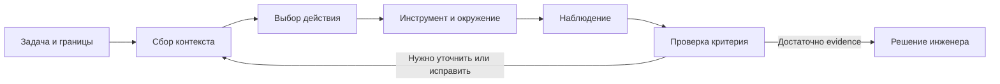

# Основы работы с AI-агентами

От поручения — к результату, который можно проверить.

## 1. Что вы научитесь делать

Это вводный урок Р1.01 курса AI-Assisted Engineering. Он рассчитан на инженера, который уже общался с LLM, но хочет понять, как передавать агенту работу с программным проектом. Уровень — начальный в agentic coding; технические пояснения пригодятся и опытным разработчикам. Ориентировочное время — 45–60 минут вместе с практикой, без установки инструментов.

После урока вы сможете:

- различать модель, агент, harness, инструмент и окружение;
- проследить цикл «контекст → действие → наблюдение → проверка»;
- отличить намерение и убедительный отчёт от подтверждённого действия;
- составить ограниченное поручение с критериями приёмки;
- определить, когда нужен агент, когда достаточно диалога, а когда полезнее скрипт.

Для основной практики достаточно браузера и умения читать небольшой фрагмент кода. Аккаунт у поставщика модели, Git и терминал не требуются. Необязательный запуск примера рассчитан на установленный Node.js; подробно установка среды рассматривается в следующих уроках.

Сквозной пример — Engineering Workbench, предложенный для курса сервис инженерных заявок. В этом уроке используется только самостоятельный фрагмент правила валидации. Полного клиента, API и базы данных пока нет; их работоспособность здесь не подразумевается.

## 2. Зачем инженеру понимать агента

Представьте задачу: «Не разрешать создавать заявку с заголовком из одних пробелов». Ассистент отвечает: «Добавил валидацию. Всё работает». Для приёмки этого недостаточно: неизвестно, какой файл изменён, какой случай проверен и относится ли проверка к текущей версии кода.

До использования агента инженер сам находил обработчик, менял код, запускал тесты и читал результат. Обычный диалог с моделью помогает придумать исправление, но перенос предложенного кода в проект и проверка остаются отдельными действиями. Агентный инструмент может участвовать в этой последовательности: искать файлы, редактировать их и запускать доступные проверки. Практическая документация VS Code описывает именно сочетание модели и инструментов для работы с кодом. [Microsoft: агентная работа](https://code.visualstudio.com/docs/agents/overview).

Это меняет точку приложения усилий инженера. Нужно задать наблюдаемый результат, предоставить достаточные входы, ограничить допустимые действия и определить основания для приёмки. Хорошее поручение снижает неоднозначность; проверка показывает, что получилось в действительности.

> Основной вопрос урока: какое наблюдение позволяет перейти от «агент сказал» к «у нас есть основание принять результат»?

Понимание этого различия полезно при исправлении дефекта, исследовании legacy-кода, подготовке тестов, обновлении документации и разборе сбоя сборки. Оно также помогает остановиться вовремя: отсутствие данных или прав не следует компенсировать расширением задачи без решения инженера.

## 3. Из чего состоит агентная система

### Модель и инструменты

**Модель** получает подготовленный вход и генерирует ответ или запрос на доступное действие. **Инструмент** выполняет конкретную операцию: читает файл, ищет символ, применяет изменение или запускает команду. Сама фраза «я проверил файл» ещё не является результатом чтения.

**Harness** — программная обвязка вокруг модели. В рабочей модели курса она организует обращения к инструментам, управляет состоянием выполнения и передаёт наблюдения в следующий запрос. **Окружение** — ресурсы, с которыми система реально взаимодействует: файлы, процессы, установленные программы, сеть и права доступа. В документации Claude Code термин harness используется для слоя, предоставляющего инструменты и управляющего контекстом. [Anthropic: устройство Claude Code](https://code.claude.com/docs/en/how-claude-code-works).

В этом курсе **AI-агентом** называем систему, в которой модель вместе с инструментами и управлением выполнением решает поставленную задачу. Это рабочее определение для обучения, а не единый стандарт всех продуктов. Конкретные клиенты могут иначе разделять компоненты.

| Компонент | Вопрос, на который он помогает ответить | Пример в нашей задаче |
|---|---|---|
| Модель | Какой следующий шаг имеет смысл? | Проверить, что происходит со строкой из пробелов |
| Контекст | На каких данных основан следующий шаг? | Задание, прочитанный код и результат теста |
| Harness | Как организовано выполнение? | Передать запрос инструменту и вернуть его результат |
| Инструмент | Какое конкретное действие выполнено? | Прочитать файл или запустить test runner |
| Окружение | Что доступно и в каком состоянии? | Учебная папка, Node.js, разрешённые файлы |
| Инженер | Что считать приемлемым результатом? | Отклонить пробельный title, сохранить корректные случаи |

Название модели не описывает всю систему. Даже при одинаковой модели результаты работы могут различаться из-за входных данных, доступных инструментов, ограничений среды и обратной связи. Это инженерное объяснение возможных причин, а не утверждение о величине эффекта.

### Контекст — вход текущего шага

Контекст может включать запрос пользователя, историю, инструкции проекта, прочитанные файлы и результаты инструментов. Наличие файла в папке и включение его содержания в конкретный запрос модели — разные вещи. Механизм сборки входа зависит от клиента. [Microsoft: состав контекста](https://code.visualstudio.com/docs/agents/concepts/context).

Предположим, вы написали: «Исправь валидацию». Если агент ещё не установил, где правило применяется, он может начать с неверного компонента. Полезный первый шаг — найти код и связанные проверки. При этом передавать весь репозиторий вручную необязательно: задача может предусматривать самостоятельный поиск в оговорённой области.

Важный навык — замечать неизвестные. «Я нашёл функцию» не означает «я нашёл все места её использования». «В тестах нет ошибки» может означать, что нужного теста пока нет. Такие пробелы должны становиться вопросами или следующими действиями.

## 4. Как работает агентный цикл

### От действия к новому наблюдению

Для обучения удобно представить выполнение как последовательность:



Схема — рабочая модель курса, не обязательный внутренний алгоритм каждого продукта. Реальные шаги могут чередоваться и повторяться. Важен feedback loop: наблюдение меняет основания следующего действия. Для вопроса о коде цикл может закончиться чтением; для bugfix потребуется изменение и повторная проверка. [Anthropic: agentic loop](https://code.claude.com/docs/en/how-claude-code-works).

Начальное поручение определяет цель. Агент собирает сведения, предлагает действие, а доступный инструмент исполняет его либо возвращает отказ. Результат — содержимое файла, сообщение об ошибке, код завершения — становится новым наблюдением. Затем система сопоставляет его с задачей. Если проверка упала, нужны диагностика и исправление; если данных недостаточно, нужен поиск или вопрос.

### Намерение, действие, наблюдение и вывод

Эти четыре категории не следует смешивать:

| Категория | Пример | Что из этого следует |
|---|---|---|
| Намерение | «Сейчас проверю пробельный заголовок» | Проверка запланирована |
| Действие | Запрос запуска конкретного test runner | Сделана попытка выполнить проверку |
| Наблюдение | Четыре tests, один failed, exit code 1 | Этот запуск обнаружил несоответствие |
| Вывод | «Валидация принимает недопустимый ввод» | Объяснение, которое нужно связать с тестом и кодом |

Даже успешный вызов инструмента ограничен своей задачей. Прочитанный файл подтверждает содержание этого файла в момент чтения. Успешный unit test подтверждает поведение проверенных случаев в данном запуске. Ни одно из этих наблюдений само по себе не доказывает корректность API, интерфейса и базы данных.

### Три состояния, которые меняются независимо

Разговор содержит обсуждение и решения. Файлы содержат текущую реализацию. Процессы выполняют запущенную версию приложения. Можно изменить файл, но не перезапустить процесс; можно начать новый разговор, сохранив файлы; можно получить успешный тест на версии, которую позже изменили.

Поэтому результат проверки нужно связывать с входами и состоянием проекта. В данном уроке это два явно названных варианта функции — baseline и corrected. Позже мы будем использовать commits, diff и CI.

### Где проходят границы действий

Текст «не меняй файлы» сообщает намерение пользователя. Технические права определяют, что инструмент способен сделать. Для задачи чтения полезно ограничить запись в среде, где это поддерживается. Для изменения кода нужны согласованный scope и контролируемая рабочая копия. Возможность исполнить действие ещё не означает, что оно входит в поручение.

Документация Claude Code отдельно рассматривает текстовые инструкции и механизмы enforcement: разрешения, sandbox, hooks и checks. Их детали зависят от продукта. [Anthropic: инструкции и ограничения](https://code.claude.com/docs/en/best-practices).

Практическое правило курса: при отказе доступа, неизвестном контракте или повторяющемся необъяснённом сбое агент должен обозначить ограничение. Инженер выбирает следующий разрешённый шаг. Отключение всех ограничений не является обычным методом диагностики.

## 5. Практический разбор: заявка с пробельным заголовком

### Исходные условия и правило

Перед вами учебный модуль Engineering Workbench. Он должен принимать строку с непустым содержимым после JavaScript trim(). Для урока договоримся: число не преобразуется в строку, пустая строка и строка из пробелов отклоняются, корректный заголовок возвращается без пробелов по краям. Это проектное правило упражнения, а не универсальный стандарт валидации.

Ошибочная версия выглядит так:

```javascript
export function baseline(value) {
  if (typeof value !== 'string') return { ok: false };
  if (value.length === 0) return { ok: false };
  return { ok: true, title: value.trim() };
}
```

Строка из трёх пробелов имеет ненулевую длину. Проверка пустоты пройдена до удаления пробелов. Затем trim() возвращает пустую строку, но результат уже считается успешным. Ошибка в порядке действий: проверять нужно то представление, которое используется как нормализованный заголовок.

Исправленный вариант:

```javascript
export function corrected(value) {
  if (typeof value !== 'string') return { ok: false };
  const title = value.trim();
  if (title.length === 0) return { ok: false };
  return { ok: true, title };
}
```

### Шаг 1. Зафиксируйте критерии

Прежде чем оценивать код, составьте таблицу. Она задаёт **test oracle** — ожидаемый результат, с которым сравнивается фактический.

| Вход | Ожидаемый результат | Зачем проверять |
|---|---|---|
| Пустая строка | ok: false | Уже известный пустой случай |
| Три пробела | ok: false | Регрессия, ради которой меняем код |
| Строка « Fix CI » | ok: true, title: «Fix CI» | Сохранение корректного поведения |
| Число 7 | ok: false | Тип не преобразуется неявно |

Если проверять только пустую строку, baseline покажется исправным. Хорошая проверка должна различать конкретную ошибочную и корректную реализации. Это инженерное требование нашего примера; его нельзя заменить числом сгенерированных тестов.

### Шаг 2. Прочитайте evidence

Автор урока выполнил один и тот же набор из четырёх проверок для двух функций на Windows / PowerShell, Node.js v24.22.1, 02.11.2026. Baseline дал 3 passed, 1 failed, exit code 1. Упал whitespace-only case: вместо ok: false получено ok: true с пустым title. Corrected дал 4 passed, 0 failed, exit code 0. Подробности сохранены в [verification.md](practice/verification.md).

Это фактические результаты локального детерминированного примера. Мы не измеряли продуктивность агента, не запускали коммерческий сервис и не проверяли HTTP или storage. Педагогический trace ниже сконструирован для обучения; он не является экспортом реальной агентной сессии.

### Шаг 3. Найдите ошибку в отчёте

Разберите шесть записей учебного trace:

1. «Проверю валидацию пустого заголовка». Это намерение, инструмента пока нет.
2. Инструмент чтения вернул baseline-функцию. Теперь известно содержание этого фрагмента.
3. «Функция уже отклоняет все пустые заголовки». Это вывод. Случай с пробелами ещё не проверен.
4. Test runner выполнил baseline-suite: 3 passed, 1 failed, exit code 1. Это наблюдение о конкретном наборе случаев.
5. Подготовлено изменение: trim() выполняется перед проверкой длины. Действие создания patch не равно доказательству успешной проверки.
6. «Исправление готово: API и сохранение в БД проверены». Это отчёт, для которого trace не содержит соответствующих наблюдений.

Первая ошибка — обобщение в записи 3: проверка строки длины ноль не охватывает пробельную строку. Вторая — неподтверждённые интеграционные утверждения в записи 6. Более того, в этих шести записях ещё нет запуска corrected-suite: его тоже следует запросить. Измерение автора в предыдущем шаге не превращает неполный trace в полный журнал действий агента.

В HTML-версии можно пошагово раскрыть этот trace и проверить классификацию записей. Интерактивная схема воспроизводит учебные данные, не вызывает модель и не запускает команды на компьютере.

### Шаг 4. Составьте поручение на чтение

Для первого взаимодействия полезна задача, которая не требует изменения проекта:

```text
Прочитай practice/title-policy.mjs и practice/checks.mjs.
Объясни, как baseline обрабатывает пустую строку и пробелы.
Для каждого вывода укажи функцию и условие, на которое опираешься.
Ничего не меняй и не устанавливай.
Не объявляй тесты запущенными, если ты их не выполнял.
Перечисли неизвестные и предложи проверку, которая различает
ошибочную и исправленную реализацию.
```

Сначала цель — понять правило и evidence. Поручение на изменение добавляется отдельно: «Перенеси проверку пустоты после нормализации; сохрани проверки типов и корректного заголовка; верни изменение и результаты одного и того же набора cases до и после». Такое разделение — учебный приём, а не обязательный режим для каждой профессиональной задачи.

### Шаг 5. Необязательное воспроизведение

Основную практику можно пройти без команд. Если Node.js уже установлен, откройте терминал **в папке этого урока** и выполните:

```shell
node --version
node --test practice/baseline.test.mjs
node --test practice/corrected.test.mjs
```

Baseline должен завершиться с одной ошибкой; это ожидаемое обнаружение дефекта. Corrected должен пройти все четыре случая. Node.js документирует node:test и ненулевой код завершения при failing tests. [Node.js: test runner](https://nodejs.org/api/test.html).

Если команда не найдена, не устанавливайте зависимости наугад: воспользуйтесь сохранённым evidence и вернитесь к установке в следующем практикуме. Если тестовый файл не найден, проверьте текущую папку. Если обе версии проходят, сверяйте cases и выбранные функции: тест на пробелы мог быть исключён. Если corrected падает, сохраните фактическую ошибку и версию runtime; ожидаемый вывод не следует копировать в отчёт как наблюдаемый.

## 6. Как переносить этот подход в production

Следующие рекомендации — инженерный синтез для применения описанного цикла. Они не являются обещанием эффективности конкретного продукта.

### Legacy и большие репозитории

В старом проекте правило может существовать в нескольких местах: форме, HTTP handler, доменном модуле и импортирующем скрипте. Сначала поручите агенту построить карту использования и найти существующие проверки. Исправление одного фрагмента принимается в пределах проверенного scope; вывод о системе требует дополнительных оснований.

В monorepo укажите пакет и связанные контракты. Ограничение «редактировать только этот каталог» уменьшает область записи, но не отменяет проверку потребителей общих типов или API. Если для задачи необходимо выйти за границу, это должно стать явным изменением scope.

### Review, тесты и CI/CD

В review проверяйте не только форму patch, но и его связь с причиной дефекта. В нашем примере важно увидеть порядок trim() и проверки длины, а также неизменность test oracle. Если агент одновременно ослабил ожидание теста, зелёный результат не доказывает исправление исходной проблемы.

Локальная проверка даёт быстрый feedback. В командном процессе значимые checks повторяют в CI на версии изменения, которую собираются интегрировать. Добавление нового commit после успешной проверки меняет состояние: прежний результат нельзя автоматически приписывать новым файлам. Решение о merge или выпуске принимает назначенный владелец процесса.

### Доступ и данные

Для чтения модуля не нужен доступ к production-секретам. Учебные и диагностические примеры лучше строить на синтетических данных. Перед подключением внешнего сервиса выясните, какие данные и операции нужны именно этой задаче. Права на чтение или запуск команды не являются разрешением публиковать данные или выпускать изменение.

Нельзя считать локальный интерфейс доказательством того, что все данные обрабатываются только локально. Место исполнения команды и место работы модели — разные части архитектуры; фактический путь данных необходимо проверить у выбранного инструмента.

### Стоимость и поддерживаемость

В первом пилоте фиксируйте выполненные критерии, неудачные итерации, ожидание, review и доработку. Быстро сгенерированный patch может требовать долгой проверки. Здесь нет универсального коэффициента ускорения: сравнивать следует принятый результат на сопоставимых задачах.

Сохраняйте причины изменения, контракт и способ проверки в репозитории. Следующему инженеру или агенту должно быть понятно, почему пробелы считаются недопустимым заголовком и какой тест защищает это решение. Долгая переписка без устойчивых артефактов усложняет сопровождение.

## 7. Когда выбрать агента, диалог или скрипт

Это сравнительная инженерная модель. Оценки зависят от знакомости с кодом, доступных tools и цены ошибки; отдельного benchmark мы не проводили.

| Подход | Полезен для | Внедрение и сопровождение | Ограничение | Как проверять |
|---|---|---|---|---|
| Диалог без исполнения | Объяснить функцию, обсудить альтернативы | Низкий старт; контекст и перенос результата ведёт инженер | Может обсуждать устаревший или неполный код | Сопоставить ответ с актуальным исходником |
| Агент с ограниченными инструментами | Найти причину, изменить несколько связанных файлов, выполнить checks | Нужны setup, границы доступа и review | Ошибочный scope или oracle ведут к неверному результату | Текущий diff, независимые критерии и реальные проверки |
| Детерминированный скрипт | Повторить заранее определённое преобразование | Нужно описать алгоритм и поддерживать его | Не решает неопределённую задачу самостоятельно | Проверки входов/выходов, fixtures и тесты |
| Работа инженера вручную | Небольшое знакомое исправление или высокорисковое решение | Нет агентного setup; всё равно нужны проверки | Время и внимание человека ограничены | Review и те же критерии приёмки |

Если нужно поменять известное значение в точно заданном списке файлов, скрипт может быть проще для анализа. Если сначала нужно найти, где и почему нарушается правило, агент может помочь с исследованием. Если стоимость настройки и проверки превышает стоимость понятной ручной правки, автоматизация не обязательна.

Агент может подготовить скрипт, а скрипт — дать агенту точную обратную связь. Подходы сочетаются. Выбирайте их по структуре задачи и доказательствам, которые сможете получить.

## 8. Самостоятельное задание

### Базовый вариант: провести мини-аудит

Возьмите trace из практического разбора и создайте два файла по шаблонам из папки practice. В agent-loop-map.md классифицируйте все шесть записей, назовите инструмент или укажите «не выполнялось», отделите наблюдаемый факт от вывода. Найдите минимум два расхождения между отчётом и evidence.

В task-contract.md подготовьте поручение новому исполнителю: объяснить дефект baseline, не изменяя файлы. Укажите входы, допустимые действия, критерии ответа и условия остановки. В HTML можно заполнить текст контракта и скачать его; копия останется у вас в обычном Markdown-файле.

Задание выполнено, если:

- классифицированы все шесть записей и показана причина классификации;
- в записи 3 найдено необоснованное обобщение, а в записи 6 — неподтверждённые API/БД checks;
- отдельно замечено отсутствие запуска corrected-suite внутри trace;
- контракт содержит цель, входы, scope, проверяемые критерии и ожидаемые evidence;
- решение инженера ограничено реально подтверждённым результатом.

### Продвинутый вариант: выбрать границу автоматизации

Предложите, какую часть задачи отдать детерминированному скрипту, какую — агенту, какую оставить инженеру. Для каждого выбора назовите вход, выход, ошибочный сценарий и проверку. Например, test runner может вычислять результаты фиксированных cases, агент — исследовать новое место применения правила, инженер — согласовать изменение бизнес-требования.

Критерий приёмки: объяснены минимум три границы ответственности и разобран один случай, когда больше автономности увеличивает стоимость проверки. Подробные шаблоны и ориентиры оценки находятся в [exercises.md](exercises.md).

## 9. Проверка знаний

### 1. Модель предложила правильную функцию в сообщении. Изменился ли проект?

Нет оснований так считать. Нужен результат действия, изменяющего файлы, либо ручное внесение правки. Корректный текст ответа и состояние рабочего проекта — разные наблюдения.

### 2. Чем harness отличается от модели?

В принятой рабочей модели harness организует выполнение вокруг модели: доступные tools, передачи результатов и состояние шага. Модель формирует ответ или предложение следующего действия. Детали реализации зависят от продукта.

### 3. Агент прочитал validation-функцию и заявил, что весь сервис корректен. Что попросить?

Попросите сузить вывод до прочитанного фрагмента и перечислить неизвестные. Для общего утверждения нужны основания по другим компонентам и критериям. Отдельно выясните, какие checks выполнены и к какой версии относятся.

### 4. Все четыре unit cases прошли. Можно ли утверждать, что запись сохраняется в базе?

Нет. В нашем примере проверялась чистая функция, у которой нет БД. Для persistence нужен отдельный сценарий с реальным хранилищем и чтением после предусмотренного перезапуска.

### 5. Почему тест только на пустую строку не обнаруживает ошибку baseline?

Потому что строка из пробелов до нормализации имеет ненулевую длину. Нужен вход, который проходит ошибочную проверку и нарушает согласованное правило после trim().

### 6. Агенту написали «не меняй файлы». Достаточно ли этого для технической изоляции?

Нет. Это инструкция о scope. Фактические возможности определяются правами инструментов и окружения. Для ограничения записи используйте поддерживаемые механизмы среды и проверяйте их конфигурацию.

### 7. Проверка упала из-за отсутствующего runtime. Доказано ли, что код ошибочен?

Нет: пока наблюдается проблема исполнения проверки. Сначала отделите ошибку окружения от нарушения бизнес-правила. Не меняйте application code, чтобы скрыть недостающую предпосылку.

### 8. Когда выбрать скрипт вместо агента?

Когда преобразование уже определено и его проще явно описать и проверить. Наличие AI не требует делегировать ему каждую операцию. Решение зависит от стоимости реализации, поддержки и верификации.

## 10. Что сохранить после урока

Агентная работа становится управляемой, когда цель связана с наблюдаемым результатом. Для следующей задачи у вас должны быть четыре вещи: понятный scope, нужные входы, критерии приёмки и способ получить evidence. Возможности инструмента и ответственность за решение нужно рассматривать отдельно.

Сохраните agent-loop-map.md и task-contract.md. Эти небольшие артефакты пригодятся при первом запуске клиента и передаче задачи другой сессии. Если пока не можете объяснить, что подтверждает конкретная проверка, вернитесь к разбору trace — это важнее выбора более мощной модели.

По рекомендуемому маршруту следующий урок — Р1.04 «Папка, файл, редактор и терминал», затем устройство приложения и выбор инструмента. Сейчас для этих тем подготовлены планы; готовый текст не подразумевается. [План Р1.04](../04-files-editor-terminal/research/outline.md).

Источники с датами проверки и границами применимости собраны в [references.md](references.md). Урок написан 02.11.2026. Продуктовые механизмы сверены с официальной документацией; схема процесса, контракт и production-рекомендации являются инженерным синтезом. Пример кода выполнен локально, учебный trace явно смоделирован.
