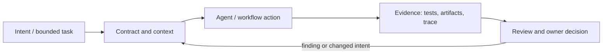

# Исследование Р4.01: SDD и три уровня зрелости спецификации

## Метаданные
- Исследование / проверка источников: 2026-11-02.
- Зависимости: Р3.08; требования, тесты и acceptance criteria (GAP-04/GAP-05).
- Scope: technical concepts, alternatives, production constraints and a lesson plan; no lesson draft, product install, benchmark or executable run.
- Evidence policy: product documentation is primary for documented product behavior, not for independent effectiveness claims. “Expected” demonstration output is not observed output.

## Исследовательские вопросы и ответы
### 1. Что подтверждено о трёх уровнях?

Ничего кроме названия: источник и определения не установлены. В outline предлагается лестница только как рабочая модель курса. [SRC-401](sources.md#src-401), [SRC-402](sources.md#src-402)
### 2. Чем требование отличается от дизайна?

Требование задаёт нужное поведение/ограничение; дизайн описывает выбранный способ реализации. Смешение связывает намерение с одной архитектурой преждевременно. [SRC-401](sources.md#src-401), [SRC-402](sources.md#src-402)
### 3. Что означает spec-driven здесь?

Спецификация участвует в формировании задач, реализации и проверке; степень формализации зависит от конкретного workflow. [SRC-401](sources.md#src-401), [SRC-402](sources.md#src-402)
### 4. Как измерить зрелость?

Проверять однозначность и тестируемость требований, traceability, контроль изменений, долю подтверждённых критериев и стоимость сопровождения; не использовать непривязанный балл. [SRC-401](sources.md#src-401), [SRC-402](sources.md#src-402)
### 5. Когда spec избыточна?

Для локальной обратимой правки с очевидным acceptance oracle; достаточно краткого task contract и проверки. [SRC-401](sources.md#src-401), [SRC-402](sources.md#src-402)

## Определения, механизмы и границы
SDD is used for several workflows, not one universally fixed standard. The three named maturity levels have no established definition or source in the curriculum. Preserve the title; propose a teaching ladder only as a working model: task contract → feature specification linked to checks → maintained executable/traceable specification lifecycle.

### Внутренняя модель
Trace the chain need → requirement → acceptance criterion → design decision → code/test evidence. Classify what is normative intent, derived plan, implementation and verification. The maturity ladder should be rated by evidence coverage and lifecycle ownership, not number of markdown files.

Диаграмма — учебная абстракция. Она не заявляет, что конкретный продукт реализует все компоненты в таком порядке.

## Сравнение альтернатив
Матрица — качественный trade-off analysis, не benchmark. Для внедрения нужно согласовать risk weights и измерить на общей задаче.

| Alternative | Fit / trade-off | Adoption effort | Maintenance | Safety | Verifiability | Applicability |
|---|---|---|---|---|---|---|
| Ticket plus tests | Low ceremony; can leave intent implicit | Varies by project | Maintenance depends on ownership/versioning | Least privilege and audit required where side effects exist | Check against fixed acceptance oracle | Applicable only within stated scope |
| TDD | Fast executable feedback; can miss untested requirement dimensions | Varies by project | Maintenance depends on ownership/versioning | Least privilege and audit required where side effects exist | Check against fixed acceptance oracle | Applicable only within stated scope |
| Spec-linked change package | More traceability; adds writing/reconciliation effort | Varies by project | Maintenance depends on ownership/versioning | Least privilege and audit required where side effects exist | Check against fixed acceptance oracle | Applicable only within stated scope |
| Full SDD lifecycle | Useful for complex/high-risk changes; may become bureaucracy | Varies by project | Maintenance depends on ownership/versioning | Least privilege and audit required where side effects exist | Check against fixed acceptance oracle | Applicable only within stated scope |

## Разобранная авторская демонстрация
**Сценарий:** Use one Workbench status transition; compare a terse ticket, acceptance criteria and a linked spec/test map. Show a missing negative case as a gap. Do not claim that writing a spec alone proves implementation correctness.

**Статус:** спроектированный documentary walkthrough на Engineering Workbench; в этом исследовании запусков не было. Планируемые проверки/артефакты ниже — ожидаемые, не фактические результаты. В будущем уроке среду, версии, команды и фактический вывод указывать отдельно.

## Production engineering
Legacy behavior needs characterization tests before redefining intent. Define owners, traceability, change history and criteria for obsolete specs. Manage duplicate documentation and review cost.

Общие контрольные вопросы для перехода в production: brownfield baseline и compatibility; ownership/approval; least privilege, secret handling and trust boundary; deterministic tests and CI; code review; audit/provenance; latency, tokens, license/access and review/rework cost; rollback/recovery; failure and upgrade behavior.

## Claims and evidence
| Утверждение | Уверенность | SRC-ID | Ограничения |
|---|---|---|---|
| Определение/механизм темы «SDD и три уровня зрелости спецификации». | Verified for cited sources / Interpretation where course-specific | SRC-401, SRC-402, SRC-424 | Не переносить продуктовые детали между harness; working definition прямо отмечена выше. |
| Значимые ограничения и production controls документированы у соответствующего первоисточника. | Verified guidance | SRC-401, SRC-402, SRC-424 | Рекомендации не доказывают итоговую эффективность и не являются результатом исполнения. |
| Сценарий Workbench можно показать в lesson. | Interpretation | — | Только спроектированный walkthrough; приложение/agent/workflow не запускались. |

## Неопределённости и работа до lesson draft
Найти владельца модели «три уровня», оригинальный источник и intended definitions. До ответа не публиковать proposed ladder как факт.

До подготовки урока перепроверить динамические страницы, выбрать harness/версии, сохранить доступные официальные документы и не исполнять непроверенные install-команды. Если практическая среда недоступна, оставить материал как документальный разбор.
