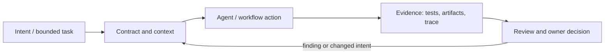

# Исследование Р4.02: Паттерн 4. Спецификации из X последовательных файлов (детерминированные стадии)

## Метаданные
- Исследование / проверка источников: 2026-11-02.
- Зависимости: Р4.01, Р4.04.
- Scope: technical concepts, alternatives, production constraints and a lesson plan; no lesson draft, product install, benchmark or executable run.
- Evidence policy: product documentation is primary for documented product behavior, not for independent effectiveness claims. “Expected” demonstration output is not observed output.

## Исследовательские вопросы и ответы
### 1. Какое значение X задано curriculum?

Не указано. Не выводить X из примера Spec Kit/OpenSpec/Kiro и не объявлять их файлами автора паттерна. [SRC-402](sources.md#src-402), [SRC-403](sources.md#src-403)
### 2. Что можно назвать детерминированным?

Порядок переходов, схемы и контрольные условия, если их исполняет определённый код. Генеративный результат и корректность не становятся детерминированными автоматически. [SRC-402](sources.md#src-402), [SRC-403](sources.md#src-403)
### 3. Что должно произойти при изменении требования?

Определить зависимые артефакты, пересмотреть их и повторить соответствующие gates/tests; иначе возникает drift. [SRC-402](sources.md#src-402), [SRC-403](sources.md#src-403)
### 4. Когда полезны отдельные файлы?

Когда стадии имеют разных владельцев/reviewers, долговременную ценность или самостоятельное применение; не ради формального числа. [SRC-402](sources.md#src-402), [SRC-403](sources.md#src-403)
### 5. Как сравнить X-file workflow?

Зафиксировать единый кейс, проверить число ручных переходов, пропуски, время, rework и sync burden; сравнение без baseline не доказывает выгоду. [SRC-402](sources.md#src-402), [SRC-403](sources.md#src-403)

## Определения, механизмы и границы
Название не указывает, какое значение X или обязательный набор файлов предполагается. Спецификации, планы и задачи могут быть разделены на артефакты со стадийными входами/выходами; это process pattern курса, не универсальная формула. «Детерминированность» может относиться к порядку/gates, но не гарантирует детерминированный текст LLM или корректность.

### Внутренняя модель
На каждой стадии задать owner, input version, question it resolves, output schema, exit criterion, allowed side effects и путь возврата. Связь должен хранить явные IDs/links. Gate может быть автоматическим schema/check или человеческим approval. Изменение upstream intent инвалидирует зависимые решения и требует повторной проверки.

Диаграмма — учебная абстракция. Она не заявляет, что конкретный продукт реализует все компоненты в таком порядке.

## Сравнение альтернатив
Матрица — качественный trade-off analysis, не benchmark. Для внедрения нужно согласовать risk weights и измерить на общей задаче.

| Alternative | Fit / trade-off | Adoption effort | Maintenance | Safety | Verifiability | Applicability |
|---|---|---|---|---|---|---|
| One evolving document | Least tooling, weak ownership separation | Varies by project | Maintenance depends on ownership/versioning | Least privilege and audit required where side effects exist | Check against fixed acceptance oracle | Applicable only within stated scope |
| Fixed staged files | Clear handoff/traceability, more sync cost | Varies by project | Maintenance depends on ownership/versioning | Least privilege and audit required where side effects exist | Check against fixed acceptance oracle | Applicable only within stated scope |
| State machine with gates | Explicit transitions, requires orchestration | Varies by project | Maintenance depends on ownership/versioning | Least privilege and audit required where side effects exist | Check against fixed acceptance oracle | Applicable only within stated scope |
| Adaptive lightweight workflow | Less overhead, risk inconsistent outputs | Varies by project | Maintenance depends on ownership/versioning | Least privilege and audit required where side effects exist | Check against fixed acceptance oracle | Applicable only within stated scope |

## Разобранная авторская демонстрация
**Сценарий:** Смоделировать изменение требования: propose → spec → design/plan → tasks → implementation/checks. На середине scope меняется; показать invalidation, delta и возврат на владельца артефакта. Число файлов не задавать до источника X; исследовательский walkthrough не исполнен.

**Статус:** спроектированный documentary walkthrough на Engineering Workbench; в этом исследовании запусков не было. Планируемые проверки/артефакты ниже — ожидаемые, не фактические результаты. В будущем уроке среду, версии, команды и фактический вывод указывать отдельно.

## Production engineering
Для brownfield минимизировать артефакты и сохранить актуальные system constraints; добавить историю и контроль доступа. Gates влияют на lead time; автоматические генераторы могут плодить дубли. Контроль rollout/rollback относится к system design, не к документационному файлу.

Общие контрольные вопросы для перехода в production: brownfield baseline и compatibility; ownership/approval; least privilege, secret handling and trust boundary; deterministic tests and CI; code review; audit/provenance; latency, tokens, license/access and review/rework cost; rollback/recovery; failure and upgrade behavior.

## Claims and evidence
| Утверждение | Уверенность | SRC-ID | Ограничения |
|---|---|---|---|
| Определение/механизм темы «Паттерн 4. Спецификации из X последовательных файлов (детерминированные стадии)». | Verified for cited sources / Interpretation where course-specific | SRC-402, SRC-403, SRC-405, SRC-404 | Не переносить продуктовые детали между harness; working definition прямо отмечена выше. |
| Значимые ограничения и production controls документированы у соответствующего первоисточника. | Verified guidance | SRC-402, SRC-403, SRC-405, SRC-404 | Рекомендации не доказывают итоговую эффективность и не являются результатом исполнения. |
| Сценарий Workbench можно показать в lesson. | Interpretation | — | Только спроектированный walkthrough; приложение/agent/workflow не запускались. |

## Неопределённости и работа до lesson draft
Подтвердить у автора curriculum X, список файлов, смыслы gates, возобновления/отката и происхождение выражения «детерминированные стадии».

До подготовки урока перепроверить динамические страницы, выбрать harness/версии, сохранить доступные официальные документы и не исполнять непроверенные install-команды. Если практическая среда недоступна, оставить материал как документальный разбор.
