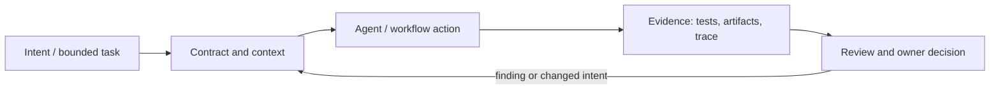

# Исследование Р4.03: Паттерн 5. Agent Loops / Harness Engineering

## Метаданные
- Исследование / проверка источников: 2026-11-02.
- Зависимости: Р4.05, Р4.07; контракты tools, bounded execution и recovery (GAP-08/GAP-09).
- Scope: technical concepts, alternatives, production constraints and a lesson plan; no lesson draft, product install, benchmark or executable run.
- Evidence policy: product documentation is primary for documented product behavior, not for independent effectiveness claims. “Expected” demonstration output is not observed output.

## Исследовательские вопросы и ответы
### 1. Какие части принадлежат harness?

Зависит от системы; типично loop/state/tool routing/control/permissions/observability, но документировать надо конкретную реализацию. [SRC-408](sources.md#src-408), [SRC-409](sources.md#src-409)
### 2. Почему нужны stop conditions?

Иначе цикл может бесконечно повторять ошибку, наращивая latency, cost и side effects. [SRC-408](sources.md#src-408), [SRC-409](sources.md#src-409)
### 3. Когда retry безопасен?

Если операция идемпотентна или ключ/состояние предотвращает дублирование, а ошибка классифицирована как transient. [SRC-408](sources.md#src-408), [SRC-409](sources.md#src-409)
### 4. Нужна ли approval перед каждым tool call?

Нет; approval привязывают к риску и побочным эффектам. Validation стоит ставить у границы tool, где происходит действие. [SRC-408](sources.md#src-408), [SRC-409](sources.md#src-409)
### 5. Что измерять кроме успешного ответа?

Корректность, evidence, вызовы/retries, safety, отказоустойчивость, latency, затраты и вмешательства. [SRC-408](sources.md#src-408), [SRC-409](sources.md#src-409)

## Определения, механизмы и границы
Agent loop — итерация модели, tool/action, наблюдения результата и следующего решения до условия остановки. Harness engineering — практическое проектирование control plane вокруг модели: tools, state, permissions, validation, budgets, checkpoints, observability. Термин используется в индустрии, но охват «harness engineering» зависит от автора.

### Внутренняя модель
Определить initial state/input; получать модельное решение; валидировать аргумент; вызывать ограниченный tool; приводить результат в компактный observation; обновлять state; оценивать done/blocked/continue; enforce max turns/time/cost; сериализовать checkpoint; обеспечивать cancellation/retry/idempotency; emit trace. Разделять harness и execution sandbox.

Диаграмма — учебная абстракция. Она не заявляет, что конкретный продукт реализует все компоненты в таком порядке.

## Сравнение альтернатив
Матрица — качественный trade-off analysis, не benchmark. Для внедрения нужно согласовать risk weights и измерить на общей задаче.

| Alternative | Fit / trade-off | Adoption effort | Maintenance | Safety | Verifiability | Applicability |
|---|---|---|---|---|---|---|
| Manual scripted workflow | Predictable, less flexible | Varies by project | Maintenance depends on ownership/versioning | Least privilege and audit required where side effects exist | Check against fixed acceptance oracle | Applicable only within stated scope |
| Model-controlled loop | Adaptable, variable behavior and stop risk | Varies by project | Maintenance depends on ownership/versioning | Least privilege and audit required where side effects exist | Check against fixed acceptance oracle | Applicable only within stated scope |
| Managed agent runtime | Lower setup, provider coupling | Varies by project | Maintenance depends on ownership/versioning | Least privilege and audit required where side effects exist | Check against fixed acceptance oracle | Applicable only within stated scope |
| Custom harness | Control/observability, engineering and ops cost | Varies by project | Maintenance depends on ownership/versioning | Least privilege and audit required where side effects exist | Check against fixed acceptance oracle | Applicable only within stated scope |

## Разобранная авторская демонстрация
**Сценарий:** На псевдокоде разрешить закрытие request через один tool: validate schema/permission, approval перед side effect, выполнить идемпотентно, записать result, stop при success/error/budget. Показать timeout и duplicate retry. Код намеренно иллюстративный до выбора SDK.

**Статус:** спроектированный documentary walkthrough на Engineering Workbench; в этом исследовании запусков не было. Планируемые проверки/артефакты ниже — ожидаемые, не фактические результаты. В будущем уроке среду, версии, команды и фактический вывод указывать отдельно.

## Production engineering
Модель: восстановление и replay; секреты остаются в trusted control plane; sandbox runtime отделён от orchestration; retries ограничены, error classes различены. Метрики: completion/correctness, tool errors, retries, unsafe calls, latency, token/cost и human interruption.

Общие контрольные вопросы для перехода в production: brownfield baseline и compatibility; ownership/approval; least privilege, secret handling and trust boundary; deterministic tests and CI; code review; audit/provenance; latency, tokens, license/access and review/rework cost; rollback/recovery; failure and upgrade behavior.

## Claims and evidence
| Утверждение | Уверенность | SRC-ID | Ограничения |
|---|---|---|---|
| Определение/механизм темы «Паттерн 5. Agent Loops / Harness Engineering». | Verified for cited sources / Interpretation where course-specific | SRC-408, SRC-409, SRC-410 | Не переносить продуктовые детали между harness; working definition прямо отмечена выше. |
| Значимые ограничения и production controls документированы у соответствующего первоисточника. | Verified guidance | SRC-408, SRC-409, SRC-410 | Рекомендации не доказывают итоговую эффективность и не являются результатом исполнения. |
| Сценарий Workbench можно показать в lesson. | Interpretation | — | Только спроектированный walkthrough; приложение/agent/workflow не запускались. |

## Неопределённости и работа до lesson draft
Выбрать SDK/runtime, storage, sandbox, observability backend и failure semantics перед runnable tutorial; product behavior must be rechecked.

До подготовки урока перепроверить динамические страницы, выбрать harness/версии, сохранить доступные официальные документы и не исполнять непроверенные install-команды. Если практическая среда недоступна, оставить материал как документальный разбор.
