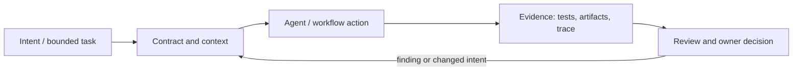

# Исследование Р4.04: Паттерн 3. Ask-before-writing на уровне спеки

## Метаданные
- Исследование / проверка источников: 2026-11-02.
- Зависимости: Р3.06, Р4.01.
- Scope: technical concepts, alternatives, production constraints and a lesson plan; no lesson draft, product install, benchmark or executable run.
- Evidence policy: product documentation is primary for documented product behavior, not for independent effectiveness claims. “Expected” demonstration output is not observed output.

## Исследовательские вопросы и ответы
### 1. Чем Р4.04 отличается от Р3.06?

Р3 уточняет intent задачи; Р4 проверяет согласованность и тестируемость многочастной спецификации и связи между требованиями. [SRC-402](sources.md#src-402), [SRC-424](sources.md#src-424)
### 2. Что является блокирующей неоднозначностью?

Та, что меняет scope, бизнес-контракт, разрешения, данные/миграцию, NFR или приемочный oracle. [SRC-402](sources.md#src-402), [SRC-424](sources.md#src-424)
### 3. Кто отвечает за ответ?

Указанный product/domain/technical owner; агент может обнаружить вопрос, но не принимать скрыто бизнес-решение. [SRC-402](sources.md#src-402), [SRC-424](sources.md#src-424)
### 4. Может ли AI найти все противоречия?

Нет гарантии полноты. Checklist/tool и модель помогают, но независимый review и последующие проверки необходимы. [SRC-402](sources.md#src-402), [SRC-424](sources.md#src-424)
### 5. Как фиксировать результат?

Requirement ID, вопрос, решение/допущение, владелец, затронутые артефакты и обновлённый acceptance evidence. [SRC-402](sources.md#src-402), [SRC-424](sources.md#src-424)

## Определения, механизмы и границы
Здесь ask-before-writing означает проверку неопределённостей внутри уже оформленной спецификации до кодирования: найти двусмысленность, конфликт, незаданную границу/исключение или критерий без oracle, затем передать вопрос владельцу решения. Продолжает Р3.06: объект проверки меняется с краткого task request на взаимосвязанный набор требований.

### Внутренняя модель
Сканировать actors, states, transitions, error/negative paths, permissions, data constraints, timing, migration/compatibility and NFR; проверять consistency/completeness/testability; связывать finding с requirement ID, severity, decision owner and dependent artifacts. Нельзя превращать LLM-generated checklist в подтверждение корректности.

Диаграмма — учебная абстракция. Она не заявляет, что конкретный продукт реализует все компоненты в таком порядке.

## Сравнение альтернатив
Матрица — качественный trade-off analysis, не benchmark. Для внедрения нужно согласовать risk weights и измерить на общей задаче.

| Alternative | Fit / trade-off | Adoption effort | Maintenance | Safety | Verifiability | Applicability |
|---|---|---|---|---|---|---|
| Свободное уточнение | Контекстно, без инфраструктуры | Varies by project | Maintenance depends on ownership/versioning | Least privilege and audit required where side effects exist | Check against fixed acceptance oracle | Applicable only within stated scope |
| Структурированный checklist/linter | Повторяем, но шаблон может быть формальным | Varies by project | Maintenance depends on ownership/versioning | Least privilege and audit required where side effects exist | Check against fixed acceptance oracle | Applicable only within stated scope |
| LLM review | Быстро находит гипотезы, correlated error | Varies by project | Maintenance depends on ownership/versioning | Least privilege and audit required where side effects exist | Check against fixed acceptance oracle | Applicable only within stated scope |
| Workshop/domain review | Дороже, но нужен для критичных правил | Varies by project | Maintenance depends on ownership/versioning | Least privilege and audit required where side effects exist | Check against fixed acceptance oracle | Applicable only within stated scope |

## Разобранная авторская демонстрация
**Сценарий:** Разобрать черновик «auto-close old requests»: `old`, часовое смещение, tenant scope, race, повторное событие и audit не определены. Пройти вопрос → конкретное принятое решение → позитивный и негативный criteria, не переписывая код.

**Статус:** спроектированный documentary walkthrough на Engineering Workbench; в этом исследовании запусков не было. Планируемые проверки/артефакты ниже — ожидаемые, не фактические результаты. В будущем уроке среду, версии, команды и фактический вывод указывать отдельно.

## Production engineering
Управлять approval и протоколом решений, сохранять PII вне промпта; для API/schema/migration conflict эскалировать domain owner. Issue template или schema validation может выявить часть пробелов, но semantic review остаётся.

Общие контрольные вопросы для перехода в production: brownfield baseline и compatibility; ownership/approval; least privilege, secret handling and trust boundary; deterministic tests and CI; code review; audit/provenance; latency, tokens, license/access and review/rework cost; rollback/recovery; failure and upgrade behavior.

## Claims and evidence
| Утверждение | Уверенность | SRC-ID | Ограничения |
|---|---|---|---|
| Определение/механизм темы «Паттерн 3. Ask-before-writing на уровне спеки». | Verified for cited sources / Interpretation where course-specific | SRC-402, SRC-424, SRC-426 | Не переносить продуктовые детали между harness; working definition прямо отмечена выше. |
| Значимые ограничения и production controls документированы у соответствующего первоисточника. | Verified guidance | SRC-402, SRC-424, SRC-426 | Рекомендации не доказывают итоговую эффективность и не являются результатом исполнения. |
| Сценарий Workbench можно показать в lesson. | Interpretation | — | Только спроектированный walkthrough; приложение/agent/workflow не запускались. |

## Неопределённости и работа до lesson draft
Закрепить понятие «writing» как до реализации, не до создания любых spec-файлов. Установить severity rubric и decision ownership.

До подготовки урока перепроверить динамические страницы, выбрать harness/версии, сохранить доступные официальные документы и не исполнять непроверенные install-команды. Если практическая среда недоступна, оставить материал как документальный разбор.
