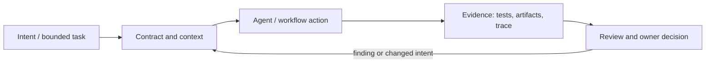

# Исследование Р4.05: Паттерн 6. Spec self/auto-evals (чек-лист + прогон агентом)

## Метаданные
- Исследование / проверка источников: 2026-11-02.
- Зависимости: Р4.02; тестовый oracle и ограничения evaluator (GAP-04–06).
- Scope: technical concepts, alternatives, production constraints and a lesson plan; no lesson draft, product install, benchmark or executable run.
- Evidence policy: product documentation is primary for documented product behavior, not for independent effectiveness claims. “Expected” demonstration output is not observed output.

## Исследовательские вопросы и ответы
### 1. Что может auto-eval спецификации проверить надёжно?

Структурные инварианты, ссылки, обязательные поля; semantic judgment needs validated rubric and human audit. [SRC-411](sources.md#src-411), [SRC-412](sources.md#src-412)
### 2. Почему авторская самопроверка слаба?

Автор и evaluator могут разделять исходную неверную assumption; независимый oracle lowers correlated error. [SRC-411](sources.md#src-411), [SRC-412](sources.md#src-412)
### 3. Должен ли reviewer-агент блокировать PR сам?

Только если его decision policy, false-positive handling, override owner and audit are explicitly engineered; typically it advises, CI tests gate. [SRC-411](sources.md#src-411), [SRC-412](sources.md#src-412)
### 4. Как снизить evaluator bias?

Explicit criteria, blind/position controls for pairwise scoring, held-out examples, human calibration and repeatability checks; no method guarantees unbiasedness. [SRC-411](sources.md#src-411), [SRC-412](sources.md#src-412)
### 5. Какое текущее ограничение OpenAI Evals API?

Официальная документация сообщает read-only с 31 Oct 2026 и план shutdown 30 Nov 2026. Recheck before lesson; do not teach as stable future dependency. [SRC-411](sources.md#src-411), [SRC-412](sources.md#src-412)

## Определения, механизмы и границы
Spec self-eval — review checklist, применённый к спецификации её автором/агентом; auto-eval — автоматическая проверка по фиксированным критериям. Это не синоним независимого quality assurance. Оценивать нужно spec coverage and consistency, а implementation correctness — отдельными oracle/test/evidence.

### Внутренняя модель
Разложить criterion → deterministic check / LLM-graded rubric / human review. Validate identifiers, required sections, links, contradictions and testability deterministically where possible; LLM can propose missing cases; reviewer accepts findings; implementation runs independent unit/integration/security checks. Version rubric/data and track false positives/negatives.

Диаграмма — учебная абстракция. Она не заявляет, что конкретный продукт реализует все компоненты в таком порядке.

## Сравнение альтернатив
Матрица — качественный trade-off analysis, не benchmark. Для внедрения нужно согласовать risk weights и измерить на общей задаче.

| Alternative | Fit / trade-off | Adoption effort | Maintenance | Safety | Verifiability | Applicability |
|---|---|---|---|---|---|---|
| Self checklist | Cheap, author blind spots remain | Varies by project | Maintenance depends on ownership/versioning | Least privilege and audit required where side effects exist | Check against fixed acceptance oracle | Applicable only within stated scope |
| Schema/lint | Fast, only syntactic/structural rules | Varies by project | Maintenance depends on ownership/versioning | Least privilege and audit required where side effects exist | Check against fixed acceptance oracle | Applicable only within stated scope |
| LLM rubric reviewer | Handles semantic prompts, bias/correlation | Varies by project | Maintenance depends on ownership/versioning | Least privilege and audit required where side effects exist | Check against fixed acceptance oracle | Applicable only within stated scope |
| Independent human + runtime tests | Costlier, stronger separation of evidence | Varies by project | Maintenance depends on ownership/versioning | Least privilege and audit required where side effects exist | Check against fixed acceptance oracle | Applicable only within stated scope |

## Разобранная авторская демонстрация
**Сценарий:** Проверить spec перехода `submitted → closed`: checklist finds no owner for unauthorized transition; validator catches missing test link only if schema defines it; model reviewer suggests concurrent duplicate close; human confirms domain relevance. Expected analysis, not a completed execution.

**Статус:** спроектированный documentary walkthrough на Engineering Workbench; в этом исследовании запусков не было. Планируемые проверки/артефакты ниже — ожидаемые, не фактические результаты. В будущем уроке среду, версии, команды и фактический вывод указывать отдельно.

## Production engineering
Использовать holdout cases, mutation/negative examples, inter-rater audit and reviewer independence. Beware author/judge shared assumptions, test leakage, flaky judge and false assurance. API operational note: OpenAI Evals docs say platform is read-only since 2026-10-31 and scheduled shutdown 2026-11-30; design examples vendor-neutral.

Общие контрольные вопросы для перехода в production: brownfield baseline и compatibility; ownership/approval; least privilege, secret handling and trust boundary; deterministic tests and CI; code review; audit/provenance; latency, tokens, license/access and review/rework cost; rollback/recovery; failure and upgrade behavior.

## Claims and evidence
| Утверждение | Уверенность | SRC-ID | Ограничения |
|---|---|---|---|
| Определение/механизм темы «Паттерн 6. Spec self/auto-evals (чек-лист + прогон агентом)». | Verified for cited sources / Interpretation where course-specific | SRC-411, SRC-412, SRC-413, SRC-402 | Не переносить продуктовые детали между harness; working definition прямо отмечена выше. |
| Значимые ограничения и production controls документированы у соответствующего первоисточника. | Verified guidance | SRC-411, SRC-412, SRC-413, SRC-402 | Рекомендации не доказывают итоговую эффективность и не являются результатом исполнения. |
| Сценарий Workbench можно показать в lesson. | Interpretation | — | Только спроектированный walkthrough; приложение/agent/workflow не запускались. |

## Неопределённости и работа до lesson draft
Для hands-on выбрать maintained eval/test tooling; переоценить статус OpenAI Evals и собрать baseline false positive/negative.

До подготовки урока перепроверить динамические страницы, выбрать harness/версии, сохранить доступные официальные документы и не исполнять непроверенные install-команды. Если практическая среда недоступна, оставить материал как документальный разбор.
