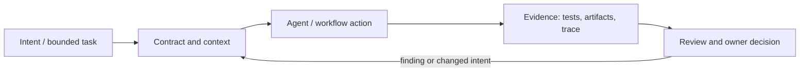

# Исследование Р4.06: Паттерн 7. Hooks: lifecycle vs git-style

## Метаданные
- Исследование / проверка источников: 2026-11-02.
- Зависимости: Р4.03, Р4.07.
- Scope: technical concepts, alternatives, production constraints and a lesson plan; no lesson draft, product install, benchmark or executable run.
- Evidence policy: product documentation is primary for documented product behavior, not for independent effectiveness claims. “Expected” demonstration output is not observed output.

## Исследовательские вопросы и ответы
### 1. Чем lifecycle event отличается от Git event?

Первый принадлежит agent session/tool loop, второй операции Git repository; разные payloads and failure semantics. [SRC-414](sources.md#src-414), [SRC-415](sources.md#src-415)
### 2. Можно ли использовать client hook как единственную quality gate?

Нет: hooks may be absent or bypassed. Enforce critical gates on trusted CI/server path. [SRC-414](sources.md#src-414), [SRC-415](sources.md#src-415)
### 3. Что надо тестировать для hook?

Discovery, event payload, nonzero exit, timeout, malformed input, duplicate sources, permissions, bypass and remote host. [SRC-414](sources.md#src-414), [SRC-415](sources.md#src-415)
### 4. Почему hook code сам является риском?

Он исполняет команду с ambient filesystem/network/environment access; plugin or repo hook can become supply-chain code execution. [SRC-414](sources.md#src-414), [SRC-415](sources.md#src-415)
### 5. Поддерживается ли один hook config всеми harness?

Нет. VS Code explicitly says hook formats and runtime compatibility vary; migrate and verify per destination. [SRC-414](sources.md#src-414), [SRC-415](sources.md#src-415)

## Определения, механизмы и границы
Lifecycle hooks вызываются событиями agent runtime (например pre-tool/post-tool/session); git-style hooks запускаются событиями Git (pre-commit, commit-msg, receive-side). Это разные event domains, payloads, execution locations, bypass/failure behavior and trust boundaries; shared word «hook» does not imply compatible scripts.

### Внутренняя модель
Для события документировать trigger, sync/async, input schema, output/decision, timeout, cwd/environment, trust, error semantics, whether it can block and observability. Runtime hook may mediate tool invocation, while Git hook cannot ensure GitHub PR checks unless server-side policy/repo CI enforces.

Диаграмма — учебная абстракция. Она не заявляет, что конкретный продукт реализует все компоненты в таком порядке.

## Сравнение альтернатив
Матрица — качественный trade-off analysis, не benchmark. Для внедрения нужно согласовать risk weights и измерить на общей задаче.

| Alternative | Fit / trade-off | Adoption effort | Maintenance | Safety | Verifiability | Applicability |
|---|---|---|---|---|---|---|
| Agent lifecycle hook | Access to runtime event, harness-specific | Varies by project | Maintenance depends on ownership/versioning | Least privilege and audit required where side effects exist | Check against fixed acceptance oracle | Applicable only within stated scope |
| Git client hook | Close to local commit, can be bypassed/not installed | Varies by project | Maintenance depends on ownership/versioning | Least privilege and audit required where side effects exist | Check against fixed acceptance oracle | Applicable only within stated scope |
| CI required check | Centralized gate, slower/paid runner dependent | Varies by project | Maintenance depends on ownership/versioning | Least privilege and audit required where side effects exist | Check against fixed acceptance oracle | Applicable only within stated scope |
| Application middleware/policy | Explicit runtime boundary, needs app integration | Varies by project | Maintenance depends on ownership/versioning | Least privilege and audit required where side effects exist | Check against fixed acceptance oracle | Applicable only within stated scope |

## Разобранная авторская демонстрация
**Сценарий:** Сравнить два проверки: `preToolUse` blocks destructive shell call versus `pre-commit` checks formatting. Deliberately consider timeout/exit/bypass and server acceptance. Hook JSON/API examples must be copied from chosen harness docs/version, not generalized.

**Статус:** спроектированный documentary walkthrough на Engineering Workbench; в этом исследовании запусков не было. Планируемые проверки/артефакты ниже — ожидаемые, не фактические результаты. В будущем уроке среду, версии, команды и фактический вывод указывать отдельно.

## Production engineering
Run hooks with least privilege; do not log full prompt/secret/tool args; protect hook code supply chain; test missing dependency, malformed event, timeout, user bypass and remote environment. VS Code docs checked currently label experience Preview. Git pre-commit is bypassable with documented `--no-verify`.

Общие контрольные вопросы для перехода в production: brownfield baseline и compatibility; ownership/approval; least privilege, secret handling and trust boundary; deterministic tests and CI; code review; audit/provenance; latency, tokens, license/access and review/rework cost; rollback/recovery; failure and upgrade behavior.

## Claims and evidence
| Утверждение | Уверенность | SRC-ID | Ограничения |
|---|---|---|---|
| Определение/механизм темы «Паттерн 7. Hooks: lifecycle vs git-style». | Verified for cited sources / Interpretation where course-specific | SRC-414, SRC-415, SRC-419 | Не переносить продуктовые детали между harness; working definition прямо отмечена выше. |
| Значимые ограничения и production controls документированы у соответствующего первоисточника. | Verified guidance | SRC-414, SRC-415, SRC-419 | Рекомендации не доказывают итоговую эффективность и не являются результатом исполнения. |
| Сценарий Workbench можно показать в lesson. | Interpretation | — | Только спроектированный walkthrough; приложение/agent/workflow не запускались. |

## Неопределённости и работа до lesson draft
Выбрать конкретную версию/harness и определить, какие events are preview; не переводить sample config в course command без local repro.

До подготовки урока перепроверить динамические страницы, выбрать harness/версии, сохранить доступные официальные документы и не исполнять непроверенные install-команды. Если практическая среда недоступна, оставить материал как документальный разбор.
