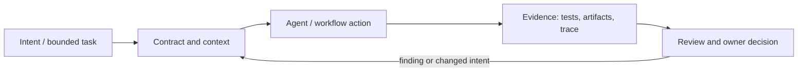

# Исследование Р4.07: Урок 11. CI/CD как loss function

## Метаданные
- Исследование / проверка источников: 2026-11-02.
- Зависимости: Р1.09, Р4.05; базовые CI и acceptance checks.
- Scope: technical concepts, alternatives, production constraints and a lesson plan; no lesson draft, product install, benchmark or executable run.
- Evidence policy: product documentation is primary for documented product behavior, not for independent effectiveness claims. “Expected” demonstration output is not observed output.

## Исследовательские вопросы и ответы
### 1. Что означает loss function в ML?

Функция ошибки/цели, связанная с оптимизацией модели во время обучения; CI run обычно не меняет параметры foundation model. [SRC-416](sources.md#src-416), [SRC-417](sources.md#src-417)
### 2. Как корректно использовать метафору для CI?

Как систематизированный сигнал о дефекте/несоответствии и стоимость его пропуска, с явными измерениями/assumptions. [SRC-416](sources.md#src-416), [SRC-417](sources.md#src-417)
### 3. Что делает CI gate?

Проверяет заданное событие в заданной среде и публикует status; policy требует, чтобы нужные checks прошли перед merge/deploy. [SRC-416](sources.md#src-416), [SRC-417](sources.md#src-417)
### 4. Почему не все проверки блокируют одинаково?

Различаются impact, confidence, runtime, flakiness and risk acceptance; условия должны быть прозрачны и иметь owner. [SRC-416](sources.md#src-416), [SRC-417](sources.md#src-417)
### 5. Как безопасно обрабатывать PR от fork?

Минимальные permissions и недоступность secrets для недоверенного workflow; раздельные privileged workflows согласно официальным security docs. [SRC-416](sources.md#src-416), [SRC-417](sources.md#src-417)

## Определения, механизмы и границы
«CI/CD как loss function» — педагогическая метафора, не стандартная терминология CI и не обучение весов LLM. CI creates repeatable feedback and gates; workflow-level expected loss could be an explicit cost/risk model (defect probability × impact + rework/review/runtime cost), but only if assumptions are visible. Training loss is a model-optimization quantity and semantically different.

### Внутренняя модель
Map spec criterion → local command → CI job/exit status → branch protection/deploy gate → owner response. Use fast deterministic checks first, tests/build/security as risk warrants; separate flaky/informational from blocking. If defining expected loss, estimate from observed project data, avoid claiming CI optimizes objective automatically.

Диаграмма — учебная абстракция. Она не заявляет, что конкретный продукт реализует все компоненты в таком порядке.

## Сравнение альтернатив
Матрица — качественный trade-off analysis, не benchmark. Для внедрения нужно согласовать risk weights и измерить на общей задаче.

| Alternative | Fit / trade-off | Adoption effort | Maintenance | Safety | Verifiability | Applicability |
|---|---|---|---|---|---|---|
| Local pre-commit | Fast feedback, not central enforcement | Varies by project | Maintenance depends on ownership/versioning | Least privilege and audit required where side effects exist | Check against fixed acceptance oracle | Applicable only within stated scope |
| PR CI checks | Central reproducible gate, slower/costly | Varies by project | Maintenance depends on ownership/versioning | Least privilege and audit required where side effects exist | Check against fixed acceptance oracle | Applicable only within stated scope |
| Continuous deployment | Fast delivery, raises recovery/observability need | Varies by project | Maintenance depends on ownership/versioning | Least privilege and audit required where side effects exist | Check against fixed acceptance oracle | Applicable only within stated scope |
| Manual release approval | Human control for high-risk rollout, adds delay | Varies by project | Maintenance depends on ownership/versioning | Least privilege and audit required where side effects exist | Check against fixed acceptance oracle | Applicable only within stated scope |

## Разобранная авторская демонстрация
**Сценарий:** Walk through pull request: syntax/type check, unit tests, integration service, security scan, required status; deliberately distinguish check failing from model weight update. Demonstration describes GitHub workflow semantics, not executed repo Actions.

**Статус:** спроектированный documentary walkthrough на Engineering Workbench; в этом исследовании запусков не было. Планируемые проверки/артефакты ниже — ожидаемые, не фактические результаты. В будущем уроке среду, версии, команды и фактический вывод указывать отдельно.

## Production engineering
Production design includes least token permissions, untrusted fork input, pinned actions, secrets, self-hosted runners, cache poisoning, latency and flaky test budgets. CI is regression barrier only for behavior captured by reliable checks; deployment needs approval/rollback.

Общие контрольные вопросы для перехода в production: brownfield baseline и compatibility; ownership/approval; least privilege, secret handling and trust boundary; deterministic tests and CI; code review; audit/provenance; latency, tokens, license/access and review/rework cost; rollback/recovery; failure and upgrade behavior.

## Claims and evidence
| Утверждение | Уверенность | SRC-ID | Ограничения |
|---|---|---|---|
| Определение/механизм темы «Урок 11. CI/CD как loss function». | Verified for cited sources / Interpretation where course-specific | SRC-416, SRC-417, SRC-423 | Не переносить продуктовые детали между harness; working definition прямо отмечена выше. |
| Значимые ограничения и production controls документированы у соответствующего первоисточника. | Verified guidance | SRC-416, SRC-417, SRC-423 | Рекомендации не доказывают итоговую эффективность и не являются результатом исполнения. |
| Сценарий Workbench можно показать в lesson. | Interpretation | — | Только спроектированный walkthrough; приложение/agent/workflow не запускались. |

## Неопределённости и работа до lesson draft
Зафиксировать математическую метафору автора курса; выбрать CI provider, project commands, baseline, branch protection and policy.

До подготовки урока перепроверить динамические страницы, выбрать harness/версии, сохранить доступные официальные документы и не исполнять непроверенные install-команды. Если практическая среда недоступна, оставить материал как документальный разбор.
