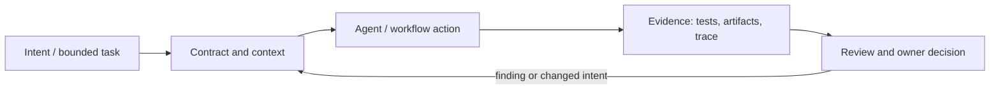

# Исследование Р4.08: Паттерн 8. Переиспользуемый workflow

## Метаданные
- Исследование / проверка источников: 2026-11-02.
- Зависимости: Р4.03, Р4.09, Р4.11.
- Scope: technical concepts, alternatives, production constraints and a lesson plan; no lesson draft, product install, benchmark or executable run.
- Evidence policy: product documentation is primary for documented product behavior, not for independent effectiveness claims. “Expected” demonstration output is not observed output.

## Исследовательские вопросы и ответы
### 1. Какие поля обязательны в workflow contract?

Inputs/types, output artifact/schema, preconditions, permissions, success criterion, failure/retry and state ownership. [SRC-408](sources.md#src-408), [SRC-416](sources.md#src-416)
### 2. Почему нельзя хранить состояние только в chat history?

Сессия can compact/disappear and replay semantics unknown; durable explicit state enables resumption and audit. [SRC-408](sources.md#src-408), [SRC-416](sources.md#src-416)
### 3. Когда нужен skill vs orchestrator?

Skill packages reusable guidance/resources; orchestrator controls stage/state/transitions and side effects. [SRC-408](sources.md#src-408), [SRC-416](sources.md#src-416)
### 4. Как предотвращать repeated side effects?

Idempotency key, dedup state, transactional/outbox pattern or check-before-write design. [SRC-408](sources.md#src-408), [SRC-416](sources.md#src-416)
### 5. Как доказать workflow improves throughput?

Compare baseline cycle time, quality/rework, cost and failure rate on representative tasks; measure setup and maintenance too. [SRC-408](sources.md#src-408), [SRC-416](sources.md#src-416)

## Определения, механизмы и границы
Reusable workflow — версионируемый процесс с определёнными входами, стадиями, результатами и условиями отказа, повторно вызываемый на сопоставимых задачах. Отличать agent skill/prompt template, orchestration graph and CI reusable workflow; одинаковый ярлык не делает их execution model одинаковой.

### Внутренняя модель
Определить contract and schema; preconditions; identity/permissions; stage transitions, durable artifacts; timeout/budget and cancellation; idempotency and retries; outputs and validation; observability/version; compatibility and deprecation. State data should be explicit, not hidden in conversation.

Диаграмма — учебная абстракция. Она не заявляет, что конкретный продукт реализует все компоненты в таком порядке.

## Сравнение альтернатив
Матрица — качественный trade-off analysis, не benchmark. Для внедрения нужно согласовать risk weights и измерить на общей задаче.

| Alternative | Fit / trade-off | Adoption effort | Maintenance | Safety | Verifiability | Applicability |
|---|---|---|---|---|---|---|
| Manual task playbook | Transparent, repeated human effort | Varies by project | Maintenance depends on ownership/versioning | Least privilege and audit required where side effects exist | Check against fixed acceptance oracle | Applicable only within stated scope |
| Prompt/skill | Low setup, model activation varies | Varies by project | Maintenance depends on ownership/versioning | Least privilege and audit required where side effects exist | Check against fixed acceptance oracle | Applicable only within stated scope |
| Orchestrator with explicit state | More reliable trace/recovery, more code | Varies by project | Maintenance depends on ownership/versioning | Least privilege and audit required where side effects exist | Check against fixed acceptance oracle | Applicable only within stated scope |
| CI reusable workflow | Deterministic automation for bounded checks, not flexible reasoning | Varies by project | Maintenance depends on ownership/versioning | Least privilege and audit required where side effects exist | Check against fixed acceptance oracle | Applicable only within stated scope |

## Разобранная авторская демонстрация
**Сценарий:** Показать flow `spec → plan → implement → checks → review summary`: одна стадия выдаёт versioned artifact, следующий consumer checks schema/hash and predecessor status. Simulate test failure and resume from checkpoint without repeating a side effect. No actual workflow run.

**Статус:** спроектированный documentary walkthrough на Engineering Workbench; в этом исследовании запусков не было. Планируемые проверки/артефакты ниже — ожидаемые, не фактические результаты. В будущем уроке среду, версии, команды и фактический вывод указывать отдельно.

## Production engineering
Review versioned dependency calls, rollback, secrets, retries, concurrency, data retention and change approval. For GitHub reusable workflows, pin external ref to SHA for stability/security where appropriate; monitor queue and cost.

Общие контрольные вопросы для перехода в production: brownfield baseline и compatibility; ownership/approval; least privilege, secret handling and trust boundary; deterministic tests and CI; code review; audit/provenance; latency, tokens, license/access and review/rework cost; rollback/recovery; failure and upgrade behavior.

## Claims and evidence
| Утверждение | Уверенность | SRC-ID | Ограничения |
|---|---|---|---|
| Определение/механизм темы «Паттерн 8. Переиспользуемый workflow». | Verified for cited sources / Interpretation where course-specific | SRC-408, SRC-416, SRC-420 | Не переносить продуктовые детали между harness; working definition прямо отмечена выше. |
| Значимые ограничения и production controls документированы у соответствующего первоисточника. | Verified guidance | SRC-408, SRC-416, SRC-420 | Рекомендации не доказывают итоговую эффективность и не являются результатом исполнения. |
| Сценарий Workbench можно показать в lesson. | Interpretation | — | Только спроектированный walkthrough; приложение/agent/workflow не запускались. |

## Неопределённости и работа до lesson draft
Выбрать workflow runtime and serialization format; examples from API vendor must be version-pinned.

До подготовки урока перепроверить динамические страницы, выбрать harness/версии, сохранить доступные официальные документы и не исполнять непроверенные install-команды. Если практическая среда недоступна, оставить материал как документальный разбор.
