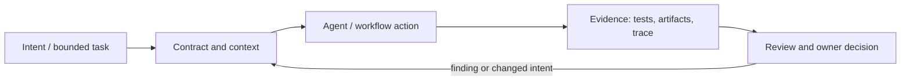

# Исследование Р4.09: Паттерн 9. Shared artifacts

## Метаданные
- Исследование / проверка источников: 2026-11-02.
- Зависимости: Р4.02, Р4.05.
- Scope: technical concepts, alternatives, production constraints and a lesson plan; no lesson draft, product install, benchmark or executable run.
- Evidence policy: product documentation is primary for documented product behavior, not for independent effectiveness claims. “Expected” demonstration output is not observed output.

## Исследовательские вопросы и ответы
### 1. Что делает artifact shared?

Несколько well-defined consumers use it across a boundary; its metadata and ownership govern what it means. [SRC-418](sources.md#src-418), [SRC-416](sources.md#src-416)
### 2. Почему immutable handoff обычно проще?

Avoids invisible overwrite and enables history/replay; explicit supersession makes the new truth visible. [SRC-418](sources.md#src-418), [SRC-416](sources.md#src-416)
### 3. Как решать два concurrent writes?

Separate writer namespaces or a single owner/merge step; define conflict semantics, do not rely on last-writer-wins blindly. [SRC-418](sources.md#src-418), [SRC-416](sources.md#src-416)
### 4. Что важнее для safety?

ACL, data minimization, provenance, retention and redaction; do not publish secrets to logs/artifacts. [SRC-418](sources.md#src-418), [SRC-416](sources.md#src-416)
### 5. Зачем нужен commit/run identity?

It links evidence to exact source and environment; without identity a stale report may be mistaken for current validation. [SRC-418](sources.md#src-418), [SRC-416](sources.md#src-416)

## Определения, механизмы и границы
Shared artifacts are durable, typed outputs used across stages, agents, CI jobs or people: spec, test report, trace, patch or decision record. A shared folder or conversation is not a contract. Distinguish immutable handoff from mutable shared state; ownership/version/concurrency semantics must be explicit.

### Внутренняя модель
Define artifact ID/type/schema/version/producer/consumer/lineage, creation time, parent run/commit, sensitivity/ACL, retention, state/ownership and supersession. Prefer append-only or immutable handoffs; mutable shared artifacts need locking/merge strategy and conflict resolution. Validate schema and provenance at boundary.

Диаграмма — учебная абстракция. Она не заявляет, что конкретный продукт реализует все компоненты в таком порядке.

## Сравнение альтернатив
Матрица — качественный trade-off analysis, не benchmark. Для внедрения нужно согласовать risk weights и измерить на общей задаче.

| Alternative | Fit / trade-off | Adoption effort | Maintenance | Safety | Verifiability | Applicability |
|---|---|---|---|---|---|---|
| Conversation handoff | Easy, weak persistence/provenance | Varies by project | Maintenance depends on ownership/versioning | Least privilege and audit required where side effects exist | Check against fixed acceptance oracle | Applicable only within stated scope |
| Shared mutable workspace | Convenient, race/corruption risk | Varies by project | Maintenance depends on ownership/versioning | Least privilege and audit required where side effects exist | Check against fixed acceptance oracle | Applicable only within stated scope |
| Immutable per-stage artifacts | Auditable, needs contracts/indexing | Varies by project | Maintenance depends on ownership/versioning | Least privilege and audit required where side effects exist | Check against fixed acceptance oracle | Applicable only within stated scope |
| Central DB/object store | Queryable, operational/security burden | Varies by project | Maintenance depends on ownership/versioning | Least privilege and audit required where side effects exist | Check against fixed acceptance oracle | Applicable only within stated scope |

## Разобранная авторская демонстрация
**Сценарий:** Two independent stages write `review.json`: show collision risk; instead write unique attempt IDs and aggregate immutable reports keyed by change+commit+stage. A CI build artifact transfers test output from one job to another but is not shared agent memory.

**Статус:** спроектированный documentary walkthrough на Engineering Workbench; в этом исследовании запусков не было. Планируемые проверки/артефакты ниже — ожидаемые, не фактические результаты. В будущем уроке среду, версии, команды и фактический вывод указывать отдельно.

## Production engineering
Production include access control, retention/deletion, signed provenance, data classification, stale artifact detection, cross-tenant isolation, storage cost and trace-to-commit linkage. Never put secrets/raw PII in reusable reports without policy.

Общие контрольные вопросы для перехода в production: brownfield baseline и compatibility; ownership/approval; least privilege, secret handling and trust boundary; deterministic tests and CI; code review; audit/provenance; latency, tokens, license/access and review/rework cost; rollback/recovery; failure and upgrade behavior.

## Claims and evidence
| Утверждение | Уверенность | SRC-ID | Ограничения |
|---|---|---|---|
| Определение/механизм темы «Паттерн 9. Shared artifacts». | Verified for cited sources / Interpretation where course-specific | SRC-418, SRC-416, SRC-408 | Не переносить продуктовые детали между harness; working definition прямо отмечена выше. |
| Значимые ограничения и production controls документированы у соответствующего первоисточника. | Verified guidance | SRC-418, SRC-416, SRC-408 | Рекомендации не доказывают итоговую эффективность и не являются результатом исполнения. |
| Сценарий Workbench можно показать в lesson. | Interpretation | — | Только спроектированный walkthrough; приложение/agent/workflow не запускались. |

## Неопределённости и работа до lesson draft
Set artifact schema, sensitivity class, retention and run identity for the course scaffold.

До подготовки урока перепроверить динамические страницы, выбрать harness/версии, сохранить доступные официальные документы и не исполнять непроверенные install-команды. Если практическая среда недоступна, оставить материал как документальный разбор.
