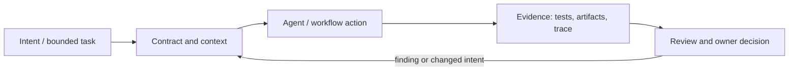

# Исследование Р4.10: Паттерн 10. Plugins/Bundles

## Метаданные
- Исследование / проверка источников: 2026-11-02.
- Зависимости: Р4.08, Р4.11; supply chain and versioning (GAP-14).
- Scope: technical concepts, alternatives, production constraints and a lesson plan; no lesson draft, product install, benchmark or executable run.
- Evidence policy: product documentation is primary for documented product behavior, not for independent effectiveness claims. “Expected” demonstration output is not observed output.

## Исследовательские вопросы и ответы
### 1. Что включает bundle?

Зависит от format; could package skills/instructions/agents/tools/hooks/MCP/config. Document manifest and activation. [SRC-419](sources.md#src-419), [SRC-420](sources.md#src-420)
### 2. Нужно ли доверять hook при установке plugin?

Нет. Code/plugin contents need review; installation and trust/approval are separate product states. [SRC-419](sources.md#src-419), [SRC-420](sources.md#src-420)
### 3. Как обновлять безопасно?

Pinned/versioned inputs, changelog review, staged rollout, compatibility tests, rollback and ownership. [SRC-419](sources.md#src-419), [SRC-420](sources.md#src-420)
### 4. Почему plugin portability is limited?

Tool names, file locations, hook event schemas, policy, execution host and model differ across harnesses. [SRC-419](sources.md#src-419), [SRC-420](sources.md#src-420)
### 5. Как оценить maintainability cost?

Count components/versions, test matrix, support surface, required permissions, update frequency, security reviews and rollback burden. [SRC-419](sources.md#src-419), [SRC-420](sources.md#src-420)

## Определения, механизмы и границы
Plugin/bundle groups reusable capabilities (instructions, skills, agents, tool integrations, scripts, hooks, config) for distribution. Formats and execution privileges are product-specific; “installed” does not imply all capabilities execute or are trusted. Research must treat package manifest, dependency resolution, permissions and update channel as attack surface.

### Внутренняя модель
Inspect manifest, files/entrypoints, target harness/versions, activation semantics, required tools/network/secrets, hooks and scripts, update and rollback; verify signatures/provenance where available; stage install in disposable scope; enumerate files/diff; test neutral and malicious inputs.

Диаграмма — учебная абстракция. Она не заявляет, что конкретный продукт реализует все компоненты в таком порядке.

## Сравнение альтернатив
Матрица — качественный trade-off analysis, не benchmark. Для внедрения нужно согласовать risk weights и измерить на общей задаче.

| Alternative | Fit / trade-off | Adoption effort | Maintenance | Safety | Verifiability | Applicability |
|---|---|---|---|---|---|---|
| Copy files manually | Transparent, drift prone | Varies by project | Maintenance depends on ownership/versioning | Least privilege and audit required where side effects exist | Check against fixed acceptance oracle | Applicable only within stated scope |
| Package manager/marketplace | Convenient updates, trust/review needed | Varies by project | Maintenance depends on ownership/versioning | Least privilege and audit required where side effects exist | Check against fixed acceptance oracle | Applicable only within stated scope |
| Repo-local bundle | Reviewable in Git, repo access risks | Varies by project | Maintenance depends on ownership/versioning | Least privilege and audit required where side effects exist | Check against fixed acceptance oracle | Applicable only within stated scope |
| Enterprise-managed plugin | Governance/rollout, admin cost and reduced autonomy | Varies by project | Maintenance depends on ownership/versioning | Least privilege and audit required where side effects exist | Check against fixed acceptance oracle | Applicable only within stated scope |

## Разобранная авторская демонстрация
**Сценарий:** Author walkthrough reviews a hypothetical testing plugin manifest: identifies a hook command and MCP server; separates static presence from execution; establishes allowlist and test plan. Do not claim installation or compatibility tested.

**Статус:** спроектированный documentary walkthrough на Engineering Workbench; в этом исследовании запусков не было. Планируемые проверки/артефакты ниже — ожидаемые, не фактические результаты. В будущем уроке среду, версии, команды и фактический вывод указывать отдельно.

## Production engineering
Pin versions/refs, review transitive dependencies, license/data-use policy, disable unneeded hook, least privilege, sandbox and rollback; centralized marketplace policy may constrain installs. Consider update cadence and support owner.

Общие контрольные вопросы для перехода в production: brownfield baseline и compatibility; ownership/approval; least privilege, secret handling and trust boundary; deterministic tests and CI; code review; audit/provenance; latency, tokens, license/access and review/rework cost; rollback/recovery; failure and upgrade behavior.

## Claims and evidence
| Утверждение | Уверенность | SRC-ID | Ограничения |
|---|---|---|---|
| Определение/механизм темы «Паттерн 10. Plugins/Bundles». | Verified for cited sources / Interpretation where course-specific | SRC-419, SRC-420, SRC-417 | Не переносить продуктовые детали между harness; working definition прямо отмечена выше. |
| Значимые ограничения и production controls документированы у соответствующего первоисточника. | Verified guidance | SRC-419, SRC-420, SRC-417 | Рекомендации не доказывают итоговую эффективность и не являются результатом исполнения. |
| Сценарий Workbench можно показать в lesson. | Interpretation | — | Только спроектированный walkthrough; приложение/agent/workflow не запускались. |

## Неопределённости и работа до lesson draft
Точнее определить whether curriculum means VS Code plugins, Codex plugins, general bundles or all; compare one release-pinned sample in a disposable environment.

До подготовки урока перепроверить динамические страницы, выбрать harness/версии, сохранить доступные официальные документы и не исполнять непроверенные install-команды. Если практическая среда недоступна, оставить материал как документальный разбор.
