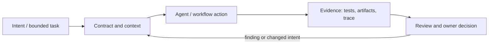

# Исследование Р4.11: Паттерн 11. Narrow API surface

## Метаданные
- Исследование / проверка источников: 2026-11-02.
- Зависимости: Р4.03; tool contracts, validation, errors and MCP boundary (GAP-08).
- Scope: technical concepts, alternatives, production constraints and a lesson plan; no lesson draft, product install, benchmark or executable run.
- Evidence policy: product documentation is primary for documented product behavior, not for independent effectiveness claims. “Expected” demonstration output is not observed output.

## Исследовательские вопросы и ответы
### 1. Почему narrow API важен для agent?

Shrinks capability and decision space; limits damage if request/model/tool routing is wrong. [SRC-422](sources.md#src-422), [SRC-408](sources.md#src-408)
### 2. Является ли JSON schema authorization?

Нет. Schema checks shape; server must enforce identity, tenant/object access and business policy. [SRC-422](sources.md#src-422), [SRC-408](sources.md#src-408)
### 3. Как моделировать retries?

Expose idempotency or dedup for side-effecting calls; classify transient/permanent errors and cap retries. [SRC-422](sources.md#src-422), [SRC-408](sources.md#src-408)
### 4. Когда broad shell is justified?

For developer tasks in isolated, least-privilege sandbox with review; not as default interface to production operations. [SRC-422](sources.md#src-422), [SRC-408](sources.md#src-408)
### 5. Какие evidence полезны при review tool?

Contract/schema, negative authz tests, timeout/retry behaviors, audit logs, permissions and output minimization. [SRC-422](sources.md#src-422), [SRC-408](sources.md#src-408)

## Определения, механизмы и границы
Narrow API surface means exposing the smallest domain-specific capability needed for a task, with explicit input/output schemas and authority, instead of broad shell/database credentials or generic admin operations. It is an engineering principle applied to agent tools, not a special protocol.

### Внутренняя модель
Choose operation by user intent, define strict schema and enums/ranges, validate authz per call/record, return minimal structured output, classify errors/retryability, apply timeout/rate limit/idempotency, audit side effects. Keep policy in trusted code. Tool descriptions aid model selection but are not access control.

Диаграмма — учебная абстракция. Она не заявляет, что конкретный продукт реализует все компоненты в таком порядке.

## Сравнение альтернатив
Матрица — качественный trade-off analysis, не benchmark. Для внедрения нужно согласовать risk weights и измерить на общей задаче.

| Alternative | Fit / trade-off | Adoption effort | Maintenance | Safety | Verifiability | Applicability |
|---|---|---|---|---|---|---|
| General shell/tool | Flexible, high blast radius | Varies by project | Maintenance depends on ownership/versioning | Least privilege and audit required where side effects exist | Check against fixed acceptance oracle | Applicable only within stated scope |
| Typed domain operation | Specific and auditable, more endpoints | Varies by project | Maintenance depends on ownership/versioning | Least privilege and audit required where side effects exist | Check against fixed acceptance oracle | Applicable only within stated scope |
| MCP integration server | Interoperable protocol, server tools still need policy | Varies by project | Maintenance depends on ownership/versioning | Least privilege and audit required where side effects exist | Check against fixed acceptance oracle | Applicable only within stated scope |
| Direct database access | Powerful, hardest to safely constrain | Varies by project | Maintenance depends on ownership/versioning | Least privilege and audit required where side effects exist | Check against fixed acceptance oracle | Applicable only within stated scope |

## Разобранная авторская демонстрация
**Сценарий:** Compare `execute_sql(sql)` or unrestricted shell with `close_request(id, reason)` constrained to allowed transitions and tenant ownership. Show invalid payload, unauthorized ID, timeout and duplicate request handling; code illustrative until actual service chosen.

**Статус:** спроектированный documentary walkthrough на Engineering Workbench; в этом исследовании запусков не было. Планируемые проверки/артефакты ниже — ожидаемые, не фактические результаты. В будущем уроке среду, версии, команды и фактический вывод указывать отдельно.

## Production engineering
Maintain API versioning, backward compatibility, authz/object-level checks, data minimization, telemetry, quotas and review. Narrow interface can still contain privileged unsafe operations; validate boundary independently and do not leak broad tokens to model.

Общие контрольные вопросы для перехода в production: brownfield baseline и compatibility; ownership/approval; least privilege, secret handling and trust boundary; deterministic tests and CI; code review; audit/provenance; latency, tokens, license/access and review/rework cost; rollback/recovery; failure and upgrade behavior.

## Claims and evidence
| Утверждение | Уверенность | SRC-ID | Ограничения |
|---|---|---|---|
| Определение/механизм темы «Паттерн 11. Narrow API surface». | Verified for cited sources / Interpretation where course-specific | SRC-422, SRC-408, SRC-410, SRC-417 | Не переносить продуктовые детали между harness; working definition прямо отмечена выше. |
| Значимые ограничения и production controls документированы у соответствующего первоисточника. | Verified guidance | SRC-422, SRC-408, SRC-410, SRC-417 | Рекомендации не доказывают итоговую эффективность и не являются результатом исполнения. |
| Сценарий Workbench можно показать в lesson. | Interpretation | — | Только спроектированный walkthrough; приложение/agent/workflow не запускались. |

## Неопределённости и работа до lesson draft
Select one tool contract and decide error, approval and idempotency semantics; no generic executable code until chosen API/runtime.

До подготовки урока перепроверить динамические страницы, выбрать harness/версии, сохранить доступные официальные документы и не исполнять непроверенные install-команды. Если практическая среда недоступна, оставить материал как документальный разбор.
