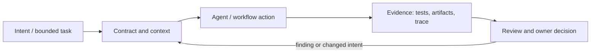

# Исследование Р4.12: Паттерн 12. Мета-подход

## Метаданные
- Исследование / проверка источников: 2026-11-02.
- Зависимости: Р4.08–Р4.10; значение термина не уточнено.
- Scope: technical concepts, alternatives, production constraints and a lesson plan; no lesson draft, product install, benchmark or executable run.
- Evidence policy: product documentation is primary for documented product behavior, not for independent effectiveness claims. “Expected” demonstration output is not observed output.

## Исследовательские вопросы и ответы
### 1. Что в curriculum определено как Meta-подход?

Definition and source are open. The lesson uses a proposed evidence-led workflow-improvement loop only if author confirms or accepts it. [SRC-409](sources.md#src-409), [SRC-411](sources.md#src-411)
### 2. Что отличает его от обычного debugging?

Target may be process/tool/context configuration rather than application defect; still requires evidence and causal caution. [SRC-409](sources.md#src-409), [SRC-411](sources.md#src-411)
### 3. Почему менять одну переменную?

Чтобы reduce confounding; if multiple settings change, observed delta cannot be attributed cleanly. [SRC-409](sources.md#src-409), [SRC-411](sources.md#src-411)
### 4. Что нельзя оптимизировать отдельно?

Proxy like tokens, number of files or cycle time without correctness, security, review/rework and user impact. [SRC-409](sources.md#src-409), [SRC-411](sources.md#src-411)
### 5. Когда rollback is necessary?

Quality/safety regression, unexplained variance, high support burden, or failure to meet agreed improvement bar. [SRC-409](sources.md#src-409), [SRC-411](sources.md#src-411)

## Определения, механизмы и границы
The curriculum offers no author or precise definition for «Мета-подход». A bounded working interpretation for outline: improve the development workflow itself using observed bottleneck/failure evidence, make one controlled process change, and evaluate it against baseline. Do not equate with self-modifying agents or automatic prompt optimization without source.

### Внутренняя модель
Observe traces, failure/rework/latency, classify root cause, create a hypothesis, change one variable (artifact, gate, tool, context or ownership), freeze comparison conditions, evaluate quality/cost/safety, accept/revert, version policy. Separate run-time adaptation from human-led workflow redesign.

Диаграмма — учебная абстракция. Она не заявляет, что конкретный продукт реализует все компоненты в таком порядке.

## Сравнение альтернатив
Матрица — качественный trade-off analysis, не benchmark. Для внедрения нужно согласовать risk weights и измерить на общей задаче.

| Alternative | Fit / trade-off | Adoption effort | Maintenance | Safety | Verifiability | Applicability |
|---|---|---|---|---|---|---|
| No deliberate improvement loop | No experiment cost, preserves pain | Varies by project | Maintenance depends on ownership/versioning | Least privilege and audit required where side effects exist | Check against fixed acceptance oracle | Applicable only within stated scope |
| A/B process change | Comparative evidence, sample/setup cost | Varies by project | Maintenance depends on ownership/versioning | Least privilege and audit required where side effects exist | Check against fixed acceptance oracle | Applicable only within stated scope |
| Continuous self-tuning | Fast adaptation, unstable governance risk | Varies by project | Maintenance depends on ownership/versioning | Least privilege and audit required where side effects exist | Check against fixed acceptance oracle | Applicable only within stated scope |
| Periodic human-led retrospection | Safe and explainable, slower | Varies by project | Maintenance depends on ownership/versioning | Least privilege and audit required where side effects exist | Check against fixed acceptance oracle | Applicable only within stated scope |

## Разобранная авторская демонстрация
**Сценарий:** Baseline a repeated request workflow, identify that review repeatedly lacks migration plan, add one explicit checklist field; compare on held-out similar changes and track missed issue rate, review time and false positives. Example is design, not measured result.

**Статус:** спроектированный documentary walkthrough на Engineering Workbench; в этом исследовании запусков не было. Планируемые проверки/артефакты ниже — ожидаемые, не фактические результаты. В будущем уроке среду, версии, команды и фактический вывод указывать отдельно.

## Production engineering
Limit meta-process budget to cadence; preserve rollback and human approval. Guard against optimizing proxy metrics (shorter prompt, lower CI time) while defects/rework increase; multi-team process changes need ownership and governance.

Общие контрольные вопросы для перехода в production: brownfield baseline и compatibility; ownership/approval; least privilege, secret handling and trust boundary; deterministic tests and CI; code review; audit/provenance; latency, tokens, license/access and review/rework cost; rollback/recovery; failure and upgrade behavior.

## Claims and evidence
| Утверждение | Уверенность | SRC-ID | Ограничения |
|---|---|---|---|
| Определение/механизм темы «Паттерн 12. Мета-подход». | Verified for cited sources / Interpretation where course-specific | SRC-409, SRC-411, SRC-421 | Не переносить продуктовые детали между harness; working definition прямо отмечена выше. |
| Значимые ограничения и production controls документированы у соответствующего первоисточника. | Verified guidance | SRC-409, SRC-411, SRC-421 | Рекомендации не доказывают итоговую эффективность и не являются результатом исполнения. |
| Сценарий Workbench можно показать в lesson. | Interpretation | — | Только спроектированный walkthrough; приложение/agent/workflow не запускались. |

## Неопределённости и работа до lesson draft
Ask curriculum author for intended method, author, mechanism and link to other named patterns; proposed loop is not industry standard.

До подготовки урока перепроверить динамические страницы, выбрать harness/версии, сохранить доступные официальные документы и не исполнять непроверенные install-команды. Если практическая среда недоступна, оставить материал как документальный разбор.
