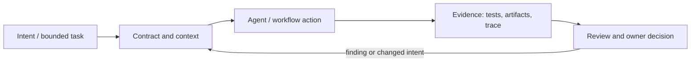

# Исследование Р4.13: Паттерн 13. Deferred context disclosure

## Метаданные
- Исследование / проверка источников: 2026-11-02.
- Зависимости: Р3.05, Р4.09.
- Scope: technical concepts, alternatives, production constraints and a lesson plan; no lesson draft, product install, benchmark or executable run.
- Evidence policy: product documentation is primary for documented product behavior, not for independent effectiveness claims. “Expected” demonstration output is not observed output.

## Исследовательские вопросы и ответы
### 1. Чем delayed disclosure не является?

Not deleting a document; it preserves a path to load selected data when relevant. Nor does it enforce access restrictions itself. [SRC-425](sources.md#src-425), [SRC-420](sources.md#src-420)
### 2. Какие два главных failure modes?

Relevant context is not discovered; stale or malicious context is loaded and trusted incorrectly. [SRC-425](sources.md#src-425), [SRC-420](sources.md#src-420)
### 3. Как проверять retrieval completeness?

Representative tasks with known required sources; measure source recall, precision, stale hits, answer correctness and latency. [SRC-425](sources.md#src-425), [SRC-420](sources.md#src-420)
### 4. Почему сохранять provenance?

Lets reviewer verify which version/path supported a decision and detect outdated or unauthorized sources. [SRC-425](sources.md#src-425), [SRC-420](sources.md#src-420)
### 5. Нужна ли vector DB?

Only if direct search/navigation is insufficient and scale/quality justify operational cost; not prerequisite to progressive disclosure. [SRC-425](sources.md#src-425), [SRC-420](sources.md#src-420)

## Определения, механизмы и границы
Deferred context disclosure is treated as context progressive loading: keep concise index/entry-point context available and reveal deeper instructions/files only when a task area or retrieval condition matches. It is a design pattern rather than a standardized protocol. Difference from simply omitting information is that the information remains discoverable with explicit activation/provenance.

### Внутренняя модель
Structure index→topic/resource→detail; describe triggers and applicability; let tools search or skill discovery load relevant artifact; cite source path/version into task; track retrieval miss and stale source; enforce data permissions before retrieval. Define fallback when trigger misses and context budget overflows.

Диаграмма — учебная абстракция. Она не заявляет, что конкретный продукт реализует все компоненты в таком порядке.

## Сравнение альтернатив
Матрица — качественный trade-off analysis, не benchmark. Для внедрения нужно согласовать risk weights и измерить на общей задаче.

| Alternative | Fit / trade-off | Adoption effort | Maintenance | Safety | Verifiability | Applicability |
|---|---|---|---|---|---|---|
| All context upfront | Simple, noisy/costly | Varies by project | Maintenance depends on ownership/versioning | Least privilege and audit required where side effects exist | Check against fixed acceptance oracle | Applicable only within stated scope |
| Curated static packet | Reliable, must manually maintain | Varies by project | Maintenance depends on ownership/versioning | Least privilege and audit required where side effects exist | Check against fixed acceptance oracle | Applicable only within stated scope |
| Progressive/file-based disclosure | Saves always-on context, discovery risk | Varies by project | Maintenance depends on ownership/versioning | Least privilege and audit required where side effects exist | Check against fixed acceptance oracle | Applicable only within stated scope |
| RAG search at runtime | Scales corpus, adds indexing/ACL/observability | Varies by project | Maintenance depends on ownership/versioning | Least privilege and audit required where side effects exist | Check against fixed acceptance oracle | Applicable only within stated scope |

## Разобранная авторская демонстрация
**Сценарий:** Map a request touching DB migration to load README + general invariants first, then migration guide/rollback policy only on migration match; unrelated UI path never loads confidential migration notes. Show expected evidence and retrieval miss fallback, no real token measurement.

**Статус:** спроектированный documentary walkthrough на Engineering Workbench; в этом исследовании запусков не было. Планируемые проверки/артефакты ниже — ожидаемые, не фактические результаты. В будущем уроке среду, версии, команды и фактический вывод указывать отдельно.

## Production engineering
ACL-aware retrieval, cache invalidation, prompt injection, change propagation, context quality/latency and what can be safely omitted. Do not rely on hidden information to enforce policy; security controls reside outside model context.

Общие контрольные вопросы для перехода в production: brownfield baseline и compatibility; ownership/approval; least privilege, secret handling and trust boundary; deterministic tests and CI; code review; audit/provenance; latency, tokens, license/access and review/rework cost; rollback/recovery; failure and upgrade behavior.

## Claims and evidence
| Утверждение | Уверенность | SRC-ID | Ограничения |
|---|---|---|---|
| Определение/механизм темы «Паттерн 13. Deferred context disclosure». | Verified for cited sources / Interpretation where course-specific | SRC-425, SRC-420, SRC-419 | Не переносить продуктовые детали между harness; working definition прямо отмечена выше. |
| Значимые ограничения и production controls документированы у соответствующего первоисточника. | Verified guidance | SRC-425, SRC-420, SRC-419 | Рекомендации не доказывают итоговую эффективность и не являются результатом исполнения. |
| Сценарий Workbench можно показать в lesson. | Interpretation | — | Только спроектированный walkthrough; приложение/agent/workflow не запускались. |

## Неопределённости и работа до lesson draft
Select one harness’s on-demand mechanism and determine context instrumentation; cost claims need measured token baseline.

До подготовки урока перепроверить динамические страницы, выбрать harness/версии, сохранить доступные официальные документы и не исполнять непроверенные install-команды. Если практическая среда недоступна, оставить материал как документальный разбор.
