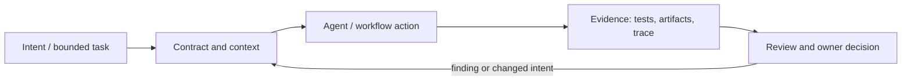

# Исследование Р4.14: Моральные принципы как инварианты

## Метаданные
- Исследование / проверка источников: 2026-11-02.
- Зависимости: Р3.03, Р4.11; AI risk governance and control design.
- Scope: technical concepts, alternatives, production constraints and a lesson plan; no lesson draft, product install, benchmark or executable run.
- Evidence policy: product documentation is primary for documented product behavior, not for independent effectiveness claims. “Expected” demonstration output is not observed output.

## Исследовательские вопросы и ответы
### 1. Можно ли превратить моральное правило в invariant?

Only a scoped, observable operational consequence can be invariant; value itself may be plural, contested and context-dependent. [SRC-421](sources.md#src-421), [SRC-417](sources.md#src-417)
### 2. Что даёт NIST AI RMF?

Risk lifecycle framing: govern, map, measure, manage; it does not certify a product as ethical or provide one universal test. [SRC-421](sources.md#src-421), [SRC-417](sources.md#src-417)
### 3. Как проверить privacy principle?

Trace actual data access, authz, retention/redaction and adversarial cases; a prompt sentence is insufficient. [SRC-421](sources.md#src-421), [SRC-417](sources.md#src-417)
### 4. Кто разрешает исключение?

Named accountable owner under transparent policy, with audit and review/appeal mechanism. [SRC-421](sources.md#src-421), [SRC-417](sources.md#src-417)
### 5. Почему metrics can mislead?

Proxy may omit affected groups or encode tradeoffs; document population, uncertainty, disaggregated results and human review. [SRC-421](sources.md#src-421), [SRC-417](sources.md#src-417)

## Определения, механизмы и границы
The title is a normative design exercise, not claim that ethics principles can be proven like program invariants. Translate value statements into context-specific policy, measurable constraints, observable tests and human decision authority, while preserving limitations and stakeholder conflicts. NIST AI RMF describes Govern/Map/Measure/Manage risk functions, not a universal moral code.

### Внутренняя модель
For principle (e.g., privacy) identify impacted actors, harm model, data flows, policy/threshold, technical control, audit evidence, exceptions/appeal and accountable owner. Use threat model, access minimization, retention/redaction test, reviewer check and incident process. Distinguish aspirational principle from verifiable claim.

Диаграмма — учебная абстракция. Она не заявляет, что конкретный продукт реализует все компоненты в таком порядке.

## Сравнение альтернатив
Матрица — качественный trade-off analysis, не benchmark. Для внедрения нужно согласовать risk weights и измерить на общей задаче.

| Alternative | Fit / trade-off | Adoption effort | Maintenance | Safety | Verifiability | Applicability |
|---|---|---|---|---|---|---|
| Values statement only | Simple, non-enforceable | Varies by project | Maintenance depends on ownership/versioning | Least privilege and audit required where side effects exist | Check against fixed acceptance oracle | Applicable only within stated scope |
| Policy and risk assessment | Clarifies scope, can remain abstract | Varies by project | Maintenance depends on ownership/versioning | Least privilege and audit required where side effects exist | Check against fixed acceptance oracle | Applicable only within stated scope |
| Technical controls/tests | Verifiable in bounded cases, incomplete harms | Varies by project | Maintenance depends on ownership/versioning | Least privilege and audit required where side effects exist | Check against fixed acceptance oracle | Applicable only within stated scope |
| Human governance/appeal | Handles contested judgment, operationally costly | Varies by project | Maintenance depends on ownership/versioning | Least privilege and audit required where side effects exist | Check against fixed acceptance oracle | Applicable only within stated scope |

## Разобранная авторская демонстрация
**Сценарий:** Take principle «do not reveal another tenant’s request». Convert to identity-bound object authorization, negative integration cases, audit review, synthetic fixtures and incident escalation. Explain why instruction alone is insufficient and how residual risk is recorded.

**Статус:** спроектированный documentary walkthrough на Engineering Workbench; в этом исследовании запусков не было. Планируемые проверки/артефакты ниже — ожидаемые, не фактические результаты. В будущем уроке среду, версии, команды и фактический вывод указывать отдельно.

## Production engineering
Stakeholder participation, jurisdiction/data protections, accessibility/fairness, audit and policy updates; beware checklist theater, proxy fairness metrics, hidden exclusions and unreviewable overrides. Human-in-loop authority and appeals need operation design.

Общие контрольные вопросы для перехода в production: brownfield baseline и compatibility; ownership/approval; least privilege, secret handling and trust boundary; deterministic tests and CI; code review; audit/provenance; latency, tokens, license/access and review/rework cost; rollback/recovery; failure and upgrade behavior.

## Claims and evidence
| Утверждение | Уверенность | SRC-ID | Ограничения |
|---|---|---|---|
| Определение/механизм темы «Моральные принципы как инварианты». | Verified for cited sources / Interpretation where course-specific | SRC-421, SRC-417, SRC-410 | Не переносить продуктовые детали между harness; working definition прямо отмечена выше. |
| Значимые ограничения и production controls документированы у соответствующего первоисточника. | Verified guidance | SRC-421, SRC-417, SRC-410 | Рекомендации не доказывают итоговую эффективность и не являются результатом исполнения. |
| Сценарий Workbench можно показать в lesson. | Interpretation | — | Только спроектированный walkthrough; приложение/agent/workflow не запускались. |

## Неопределённости и работа до lesson draft
Choose project principle, stakeholders and applicable legal policy before detailed lesson; no legal compliance claim from this outline.

До подготовки урока перепроверить динамические страницы, выбрать harness/версии, сохранить доступные официальные документы и не исполнять непроверенные install-команды. Если практическая среда недоступна, оставить материал как документальный разбор.
