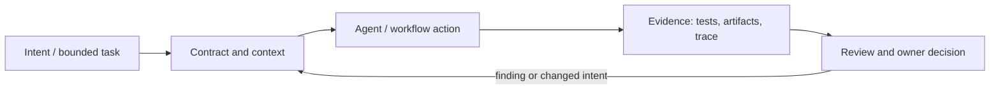

# Исследование Р4.15: Методология 1. Spec-anchored как основа сравнения

## Метаданные
- Исследование / проверка источников: 2026-11-02.
- Зависимости: Р3.08, Р4.05, Р4.08.
- Scope: technical concepts, alternatives, production constraints and a lesson plan; no lesson draft, product install, benchmark or executable run.
- Evidence policy: product documentation is primary for documented product behavior, not for independent effectiveness claims. “Expected” demonstration output is not observed output.

## Исследовательские вопросы и ответы
### 1. Что значит spec-anchored в этом сравнительном уроке?

Working course definition, carried from R3.08: requirements/artifact/check link anchors a workflow and common baseline. [SRC-401](sources.md#src-401), [SRC-403](sources.md#src-403)
### 2. Почему фиксировать baseline commit?

It holds application context constant and makes diffs/rework comparable. [SRC-401](sources.md#src-401), [SRC-403](sources.md#src-403)
### 3. Какой результат нельзя обобщать?

A single case’s ranking cannot establish universal superiority across project types, team skills or models. [SRC-401](sources.md#src-401), [SRC-403](sources.md#src-403)
### 4. Как избежать comparison leakage?

Reset to clean branch/copy and exclude outputs/decisions from previous methodology before next run. [SRC-401](sources.md#src-401), [SRC-403](sources.md#src-403)
### 5. Какие расходы учитывать?

Setup, configuration, inference, review, rework, training, maintenance, security and tool license/access. [SRC-401](sources.md#src-401), [SRC-403](sources.md#src-403)

## Определения, механизмы и границы
Continue the course working model from R3.08: a specification links agreed intent, change plan, implementation and evidence. Here it is a control baseline for later methodology comparisons, not a third-party product or standardized methodology. The baseline should be minimum viable but explicit, so other methods can be assessed against same task/outcome.

### Внутренняя модель
Freeze repository commit, change statement, requirements and acceptance oracle; specify known constraints/non-goals; allocate equal model/access/time if possible; identify which artifact/workflow is baseline vs tool-specific convenience; log deviations and version; compare implementation correctness, traceability, review/rework, setup cost and safety.

Диаграмма — учебная абстракция. Она не заявляет, что конкретный продукт реализует все компоненты в таком порядке.

## Сравнение альтернатив
Матрица — качественный trade-off analysis, не benchmark. Для внедрения нужно согласовать risk weights и измерить на общей задаче.

| Alternative | Fit / trade-off | Adoption effort | Maintenance | Safety | Verifiability | Applicability |
|---|---|---|---|---|---|---|
| Bare task/ticket baseline | Cheapest, ambiguity not controlled | Varies by project | Maintenance depends on ownership/versioning | Least privilege and audit required where side effects exist | Check against fixed acceptance oracle | Applicable only within stated scope |
| Minimal acceptance spec | Comparable intent and checks, small ceremony | Varies by project | Maintenance depends on ownership/versioning | Least privilege and audit required where side effects exist | Check against fixed acceptance oracle | Applicable only within stated scope |
| Full formal spec baseline | Strong traceability, biases against lightweight tools | Varies by project | Maintenance depends on ownership/versioning | Least privilege and audit required where side effects exist | Check against fixed acceptance oracle | Applicable only within stated scope |
| Existing project’s own workflow | Ecological validity, baseline may be mature/unequal | Varies by project | Maintenance depends on ownership/versioning | Least privilege and audit required where side effects exist | Check against fixed acceptance oracle | Applicable only within stated scope |

## Разобранная авторская демонстрация
**Сценарий:** Use Workbench close-state change with positive/negative cases; keep baseline branch and rubric; record expected artifacts without running. Later method packages start from same clean baseline and report conditions.

**Статус:** спроектированный documentary walkthrough на Engineering Workbench; в этом исследовании запусков не было. Планируемые проверки/артефакты ниже — ожидаемые, не фактические результаты. В будущем уроке среду, версии, команды и фактический вывод указывать отдельно.

## Production engineering
Do not leak earlier method artifacts into later run; same harness/model/commit and reviewer where practical, disclose unavoidable changes; estimate operational adoption and maintenance not only generated code quality.

Общие контрольные вопросы для перехода в production: brownfield baseline и compatibility; ownership/approval; least privilege, secret handling and trust boundary; deterministic tests and CI; code review; audit/provenance; latency, tokens, license/access and review/rework cost; rollback/recovery; failure and upgrade behavior.

## Claims and evidence
| Утверждение | Уверенность | SRC-ID | Ограничения |
|---|---|---|---|
| Определение/механизм темы «Методология 1. Spec-anchored как основа сравнения». | Verified for cited sources / Interpretation where course-specific | SRC-401, SRC-403, SRC-424 | Не переносить продуктовые детали между harness; working definition прямо отмечена выше. |
| Значимые ограничения и production controls документированы у соответствующего первоисточника. | Verified guidance | SRC-401, SRC-403, SRC-424 | Рекомендации не доказывают итоговую эффективность и не являются результатом исполнения. |
| Сценарий Workbench можно показать в lesson. | Interpretation | — | Только спроектированный walkthrough; приложение/agent/workflow не запускались. |

## Неопределённости и работа до lesson draft
Confirm the intended definition and common case rubric with curriculum owner; choose fixed repo commit/model/runtime before comparative execution.

До подготовки урока перепроверить динамические страницы, выбрать harness/версии, сохранить доступные официальные документы и не исполнять непроверенные install-команды. Если практическая среда недоступна, оставить материал как документальный разбор.
