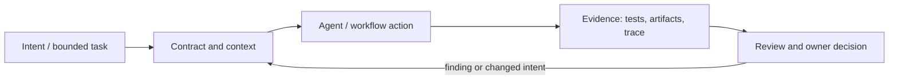

# Исследование Р4.16: Методология 2. GitHub Spec Kit

## Метаданные
- Исследование / проверка источников: 2026-11-02.
- Зависимости: Р4.15, Р3.07.
- Scope: technical concepts, alternatives, production constraints and a lesson plan; no lesson draft, product install, benchmark or executable run.
- Evidence policy: product documentation is primary for documented product behavior, not for independent effectiveness claims. “Expected” demonstration output is not observed output.

## Исследовательские вопросы и ответы
### 1. Кто выпускает Spec Kit?

GitHub project; repository and docs are primary sources for its design and release-specific details. [SRC-401](sources.md#src-401), [SRC-402](sources.md#src-402)
### 2. Какой путь описан в docs?

Current docs enumerate constitution, specify, clarify, plan, checklist, tasks, analyze, implement and converge, though commands are evolving. [SRC-401](sources.md#src-401), [SRC-402](sources.md#src-402)
### 3. Нужно ли выполнять каждый stage для every change?

The tool supports process options; teams should right-size based on impact and verify applicable template/version. [SRC-401](sources.md#src-401), [SRC-402](sources.md#src-402)
### 4. Как Spec Kit treats existing specs?

Docs describe flow-forward vs living spec choices and an analyze step, but team must select and maintain policy. [SRC-401](sources.md#src-401), [SRC-402](sources.md#src-402)
### 5. Что пока неизвестно?

No CLI execution, compatibility matrix, timings or quality comparison conducted here. [SRC-401](sources.md#src-401), [SRC-402](sources.md#src-402)

## Определения, механизмы и границы
GitHub Spec Kit is an open-source toolkit for agent-driven specification workflows, not merely a standard. Official docs describe command sequence such as constitution/specify/clarify/plan/tasks/analyze/implement/converge and evolving-spec policies; templates/invocation may change by version and agent. Analyze author/community, repository release history, artifact persistence, extension surface, adoption cost and limitations separately.

### Внутренняя модель
Documented path: establish project principles, draft user-facing spec, resolve ambiguity, derive plan/tasks, analyze artifact consistency, implement, converge against artifacts. Validate source and commands against a pinned release; distinguish core from extension-contributed behavior.

Диаграмма — учебная абстракция. Она не заявляет, что конкретный продукт реализует все компоненты в таком порядке.

## Сравнение альтернатив
Матрица — качественный trade-off analysis, не benchmark. Для внедрения нужно согласовать risk weights и измерить на общей задаче.

| Alternative | Fit / trade-off | Adoption effort | Maintenance | Safety | Verifiability | Applicability |
|---|---|---|---|---|---|---|
| Plain Markdown templates | Portable/low cost, less guided | Varies by project | Maintenance depends on ownership/versioning | Least privilege and audit required where side effects exist | Check against fixed acceptance oracle | Applicable only within stated scope |
| Spec Kit core | Structured staged process, command/tool adaptation effort | Varies by project | Maintenance depends on ownership/versioning | Least privilege and audit required where side effects exist | Check against fixed acceptance oracle | Applicable only within stated scope |
| Custom internal SDD | Fits conventions, maintenance owner burden | Varies by project | Maintenance depends on ownership/versioning | Least privilege and audit required where side effects exist | Check against fixed acceptance oracle | Applicable only within stated scope |
| Full platform IDE workflow | Integrated experience, lock-in/access governance | Varies by project | Maintenance depends on ownership/versioning | Least privilege and audit required where side effects exist | Check against fixed acceptance oracle | Applicable only within stated scope |

## Разобранная авторская демонстрация
**Сценарий:** Prepare document-only walkthrough of change for request closure: show artifact names/links and proposed gate. Do not install or execute CLI in research; report author-doc workflow as documented capability, not actual observed outcome.

**Статус:** спроектированный documentary walkthrough на Engineering Workbench; в этом исследовании запусков не было. Планируемые проверки/артефакты ниже — ожидаемые, не фактические результаты. В будущем уроке среду, версии, команды и фактический вывод указывать отдельно.

## Production engineering
Brownfield adoption needs import/context and persistence policy; evaluate generated docs burden, hooks/extensions, compatibility, version and repo review. High risk still needs independent tests and gates.

Общие контрольные вопросы для перехода в production: brownfield baseline и compatibility; ownership/approval; least privilege, secret handling and trust boundary; deterministic tests and CI; code review; audit/provenance; latency, tokens, license/access and review/rework cost; rollback/recovery; failure and upgrade behavior.

## Claims and evidence
| Утверждение | Уверенность | SRC-ID | Ограничения |
|---|---|---|---|
| Определение/механизм темы «Методология 2. GitHub Spec Kit». | Verified for cited sources / Interpretation where course-specific | SRC-401, SRC-402, SRC-403 | Не переносить продуктовые детали между harness; working definition прямо отмечена выше. |
| Значимые ограничения и production controls документированы у соответствующего первоисточника. | Verified guidance | SRC-401, SRC-402, SRC-403 | Рекомендации не доказывают итоговую эффективность и не являются результатом исполнения. |
| Сценарий Workbench можно показать в lesson. | Interpretation | — | Только спроектированный walkthrough; приложение/agent/workflow не запускались. |

## Неопределённости и работа до lesson draft
Pin GitHub Spec Kit release and agent integration; recheck commands, license, supported platform, security/access and extension effects before lesson drafting.

До подготовки урока перепроверить динамические страницы, выбрать harness/версии, сохранить доступные официальные документы и не исполнять непроверенные install-команды. Если практическая среда недоступна, оставить материал как документальный разбор.
