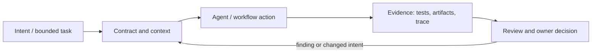

# Исследование Р4.17: Методология 3. OpenSpec

## Метаданные
- Исследование / проверка источников: 2026-11-02.
- Зависимости: Р4.15, Р3.07.
- Scope: technical concepts, alternatives, production constraints and a lesson plan; no lesson draft, product install, benchmark or executable run.
- Evidence policy: product documentation is primary for documented product behavior, not for independent effectiveness claims. “Expected” demonstration output is not observed output.

## Исследовательские вопросы и ответы
### 1. Что такое delta spec?

A per-change description of added/modified/removed behavior intended to merge into longer-lived capability specs at completion. [SRC-404](sources.md#src-404), [SRC-426](sources.md#src-426)
### 2. Что обычно делает archive?

Current documented workflow reconciles completed change records into canonical state/history; exact behavior must be checked for profile/version. [SRC-404](sources.md#src-404), [SRC-426](sources.md#src-426)
### 3. Почему есть стоимость архивирования?

It introduces a consistency boundary; skipped sync/archive can leave baseline specs stale. [SRC-404](sources.md#src-404), [SRC-426](sources.md#src-426)
### 4. Можно ли сразу утверждать все docs commands?

No, repository main changes; pin tag/commit and installed tool compatibility before lesson. [SRC-404](sources.md#src-404), [SRC-426](sources.md#src-426)
### 5. OpenSpec был запущен?

Нет. Research read official repository/docs only; no install or workflow results reported. [SRC-404](sources.md#src-404), [SRC-426](sources.md#src-426)

## Определения, механизмы и границы
OpenSpec is a project/toolkit for spec-driven change workflows. Its docs describe per-change proposal/spec delta/design/tasks and archive/sync lifecycle, plus commands and profiles that vary. Treat maintainers’ documentation as intended design; confirm exact current profile before lesson. Distinguish the long-lived capability specs from temporary change artifacts.

### Внутренняя модель
Inspect global/spec baseline; explore optional; propose a named change; generate/modify delta artifacts; review; apply; verify; archive/sync according to chosen workflow. Determine which steps mutate code vs spec and how archive changes canonical spec. Use Git as audit and rollback.

Диаграмма — учебная абстракция. Она не заявляет, что конкретный продукт реализует все компоненты в таком порядке.

## Сравнение альтернатив
Матрица — качественный trade-off analysis, не benchmark. Для внедрения нужно согласовать risk weights и измерить на общей задаче.

| Alternative | Fit / trade-off | Adoption effort | Maintenance | Safety | Verifiability | Applicability |
|---|---|---|---|---|---|---|
| OpenSpec change deltas | Excellent incremental change focus, extra archive reconciliation | Varies by project | Maintenance depends on ownership/versioning | Least privilege and audit required where side effects exist | Check against fixed acceptance oracle | Applicable only within stated scope |
| Living capability spec | Stable overview, drift if stale | Varies by project | Maintenance depends on ownership/versioning | Least privilege and audit required where side effects exist | Check against fixed acceptance oracle | Applicable only within stated scope |
| Issue + code only | Minimal artifacts, limited contract longevity | Varies by project | Maintenance depends on ownership/versioning | Least privilege and audit required where side effects exist | Check against fixed acceptance oracle | Applicable only within stated scope |
| Full staged SDD suite | More gates/traceability, heavier process | Varies by project | Maintenance depends on ownership/versioning | Least privilege and audit required where side effects exist | Check against fixed acceptance oracle | Applicable only within stated scope |

## Разобранная авторская демонстрация
**Сценарий:** Document-based change `requests.status transition`: compare persistent state with one change’s delta; follow current documented commands only as source illustration, not claim of installation or execution. Expected artifacts listed; no CLI run performed.

**Статус:** спроектированный documentary walkthrough на Engineering Workbench; в этом исследовании запусков не было. Планируемые проверки/артефакты ниже — ожидаемые, не фактические результаты. В будущем уроке среду, версии, команды и фактический вывод указывать отдельно.

## Production engineering
Multiple maintainers need branch/merge conflict policy, spec ownership, update-on-archive checks, stale specs, cross-repo workflow and migration of legacy docs. New/expanded profiles and commands require pinning.

Общие контрольные вопросы для перехода в production: brownfield baseline и compatibility; ownership/approval; least privilege, secret handling and trust boundary; deterministic tests and CI; code review; audit/provenance; latency, tokens, license/access and review/rework cost; rollback/recovery; failure and upgrade behavior.

## Claims and evidence
| Утверждение | Уверенность | SRC-ID | Ограничения |
|---|---|---|---|
| Определение/механизм темы «Методология 3. OpenSpec». | Verified for cited sources / Interpretation where course-specific | SRC-404, SRC-426 | Не переносить продуктовые детали между harness; working definition прямо отмечена выше. |
| Значимые ограничения и production controls документированы у соответствующего первоисточника. | Verified guidance | SRC-404, SRC-426 | Рекомендации не доказывают итоговую эффективность и не являются результатом исполнения. |
| Сценарий Workbench можно показать в lesson. | Interpretation | — | Только спроектированный walkthrough; приложение/agent/workflow не запускались. |

## Неопределённости и работа до lesson draft
Pin OpenSpec release/profile, inspect current command contract, migration guide and licensing; no hands-on claims until executed.

До подготовки урока перепроверить динамические страницы, выбрать harness/версии, сохранить доступные официальные документы и не исполнять непроверенные install-команды. Если практическая среда недоступна, оставить материал как документальный разбор.
