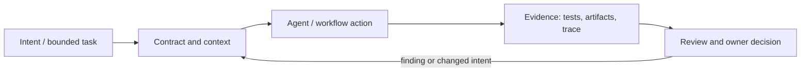

# Исследование Р4.18: Методология 4. Kiro (AWS)

## Метаданные
- Исследование / проверка источников: 2026-11-02.
- Зависимости: Р4.15, Р3.07; access to product before hands-on evaluation.
- Scope: technical concepts, alternatives, production constraints and a lesson plan; no lesson draft, product install, benchmark or executable run.
- Evidence policy: product documentation is primary for documented product behavior, not for independent effectiveness claims. “Expected” demonstration output is not observed output.

## Исследовательские вопросы и ответы
### 1. Кто автор методологии Kiro?

AWS builds Kiro product; the spec flow is documented vendor capability rather than independent standard. [SRC-405](sources.md#src-405)
### 2. Каковы core spec artifacts in docs?

Requirements/bug analysis, design, tasks; exact format and workflow options depend on current product docs. [SRC-405](sources.md#src-405)
### 3. Does task execution prove delivery quality?

No. Need independent checks and review of final code against acceptance criteria. [SRC-405](sources.md#src-405)
### 4. Что нужно для fair comparison?

Record IDE/CLI/web surface, version, account/access, model, plan and actual gates; compare same clean case. [SRC-405](sources.md#src-405)
### 5. Урок hands-on ready?

Not yet: no live access or tool execution took place; source documentation only. [SRC-405](sources.md#src-405)

## Определения, механизмы и границы
Kiro is a vendor product/agentic IDE with a documented spec workflow, not a vendor-neutral method. Docs describe requirements/user stories + acceptance criteria, design artifacts, tasks and execution/review, with feature/bugfix and variants. Analyze product surface and method concept separately; feature matrix/pricing/platform are volatile.

### Внутренняя модель
Capture feature vs bugfix decision; choose requirements-first/design-first or quick path as documented; review requirements/design, derive tasks and dependencies; execute tasks and inspect code/spec diffs. Distinguish capability claims from a measured effect such as speed.

Диаграмма — учебная абстракция. Она не заявляет, что конкретный продукт реализует все компоненты в таком порядке.

## Сравнение альтернатив
Матрица — качественный trade-off analysis, не benchmark. Для внедрения нужно согласовать risk weights и измерить на общей задаче.

| Alternative | Fit / trade-off | Adoption effort | Maintenance | Safety | Verifiability | Applicability |
|---|---|---|---|---|---|---|
| Markdown workflow portable | Low vendor coupling, no integrated UI | Varies by project | Maintenance depends on ownership/versioning | Least privilege and audit required where side effects exist | Check against fixed acceptance oracle | Applicable only within stated scope |
| Kiro spec flow | Integrated review/execution, product dependency | Varies by project | Maintenance depends on ownership/versioning | Least privilege and audit required where side effects exist | Check against fixed acceptance oracle | Applicable only within stated scope |
| Existing ticket + custom prompt | No setup, weaker consistency | Varies by project | Maintenance depends on ownership/versioning | Least privilege and audit required where side effects exist | Check against fixed acceptance oracle | Applicable only within stated scope |
| Custom self-hosted workflow | Control, significant maintenance | Varies by project | Maintenance depends on ownership/versioning | Least privilege and audit required where side effects exist | Check against fixed acceptance oracle | Applicable only within stated scope |

## Разобранная авторская демонстрация
**Сценарий:** Create paper walkthrough with request state transition: list expected requirements/design/tasks; label docs-specified output vs unknown produced files in actual current runtime. No Kiro session/account or execution available in research.

**Статус:** спроектированный documentary walkthrough на Engineering Workbench; в этом исследовании запусков не было. Планируемые проверки/артефакты ниже — ожидаемые, не фактические результаты. В будущем уроке среду, версии, команды и фактический вывод указывать отдельно.

## Production engineering
Evaluate IDE/platform access, cloud/data boundary, enterprise controls, pricing, version compatibility, generated artifact ownership, existing repo conventions and validation quality; managed product limits reproducibility.

Общие контрольные вопросы для перехода в production: brownfield baseline и compatibility; ownership/approval; least privilege, secret handling and trust boundary; deterministic tests and CI; code review; audit/provenance; latency, tokens, license/access and review/rework cost; rollback/recovery; failure and upgrade behavior.

## Claims and evidence
| Утверждение | Уверенность | SRC-ID | Ограничения |
|---|---|---|---|
| Определение/механизм темы «Методология 4. Kiro (AWS)». | Verified for cited sources / Interpretation where course-specific | SRC-405 | Не переносить продуктовые детали между harness; working definition прямо отмечена выше. |
| Значимые ограничения и production controls документированы у соответствующего первоисточника. | Verified guidance | SRC-405 | Рекомендации не доказывают итоговую эффективность и не являются результатом исполнения. |
| Сценарий Workbench можно показать в lesson. | Interpretation | — | Только спроектированный walkthrough; приложение/agent/workflow не запускались. |

## Неопределённости и работа до lesson draft
Determine accessible Kiro surface/account, version/pricing/access and export/repo semantics before drafting actual instructions.

До подготовки урока перепроверить динамические страницы, выбрать harness/версии, сохранить доступные официальные документы и не исполнять непроверенные install-команды. Если практическая среда недоступна, оставить материал как документальный разбор.
