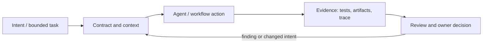

# Исследование Р4.19: Методология 5. specs.md

## Метаданные
- Исследование / проверка источников: 2026-11-02.
- Зависимости: Р4.15, Р3.07; confirm project identity.
- Scope: technical concepts, alternatives, production constraints and a lesson plan; no lesson draft, product install, benchmark or executable run.
- Evidence policy: product documentation is primary for documented product behavior, not for independent effectiveness claims. “Expected” demonstration output is not observed output.

## Исследовательские вопросы и ответы
### 1. Какой проект подразумевает curriculum?

Provisional match is `fabriqaai/specs.md`, already noted as candidate in COURSE_OVERVIEW; title alone cannot confirm intent. [SRC-406](sources.md#src-406)
### 2. Чем отличаются named flows?

Repository README frames them for ideation, lightweight specs, adaptive execution and full AI-DLC; these are author claims/product taxonomy. [SRC-406](sources.md#src-406)
### 3. Проверена portability across harnesses?

No. A support table in README is not cross-platform execution evidence. [SRC-406](sources.md#src-406)
### 4. What does install command imply?

Only documented install steps; this research did not install dependencies or evaluate file/network side effects. [SRC-406](sources.md#src-406)
### 5. Как сравнить feature claims?

Pin commit/tag; run documented test tasks across supported harnesses and report failures, human effort, security and support separately. [SRC-406](sources.md#src-406)

## Определения, механизмы и границы
The curriculum label corresponds provisionally to `fabriqaai/specs.md`, an AI-native framework with multiple named flows (Ideation, Simple, FIRE, AI-DLC), but authorial intent is not confirmed from the title alone. Its README claims broad tool compatibility and adjustable rigor; treat those as claims to verify, not independent outcome evidence.

### Внутренняя модель
Identify repository owner/tag/manifest; separate flow artifacts and agent integrations; inspect installer and generated files in disposable project; trace flow stages/checkpoints/state; compare framework core with user-selected prompts and IDE add-on. Freeze version because main README evolves.

Диаграмма — учебная абстракция. Она не заявляет, что конкретный продукт реализует все компоненты в таком порядке.

## Сравнение альтернатив
Матрица — качественный trade-off analysis, не benchmark. Для внедрения нужно согласовать risk weights и измерить на общей задаче.

| Alternative | Fit / trade-off | Adoption effort | Maintenance | Safety | Verifiability | Applicability |
|---|---|---|---|---|---|---|
| Native Markdown convention | Few dependencies, manual process | Varies by project | Maintenance depends on ownership/versioning | Least privilege and audit required where side effects exist | Check against fixed acceptance oracle | Applicable only within stated scope |
| specs.md Simple flow | Quick generation, less execution tracking | Varies by project | Maintenance depends on ownership/versioning | Least privilege and audit required where side effects exist | Check against fixed acceptance oracle | Applicable only within stated scope |
| FIRE adaptive flow | Brownfield claims, complex moving parts | Varies by project | Maintenance depends on ownership/versioning | Least privilege and audit required where side effects exist | Check against fixed acceptance oracle | Applicable only within stated scope |
| AI-DLC full flow | Traceability, greater artifact/agent burden | Varies by project | Maintenance depends on ownership/versioning | Least privilege and audit required where side effects exist | Check against fixed acceptance oracle | Applicable only within stated scope |

## Разобранная авторская демонстрация
**Сценарий:** Use document-only comparison of Simple vs AI-DLC artifact tree from README and record intended scope. Do not run `npx`, install extension, or claim cross-tool portability verified. Commands in the repo can be cited but remain untested.

**Статус:** спроектированный documentary walkthrough на Engineering Workbench; в этом исследовании запусков не было. Планируемые проверки/артефакты ниже — ожидаемые, не фактические результаты. В будущем уроке среду, версии, команды и фактический вывод указывать отдельно.

## Production engineering
Install scripts, CLI dependency, marketplace extension, remote access, file writes, telemetry, updates and generated policy are supply-chain/control concerns. Test brownfield changes, monorepo boundaries, upgrade/flow switching, repo portability and source license.

Общие контрольные вопросы для перехода в production: brownfield baseline и compatibility; ownership/approval; least privilege, secret handling and trust boundary; deterministic tests and CI; code review; audit/provenance; latency, tokens, license/access and review/rework cost; rollback/recovery; failure and upgrade behavior.

## Claims and evidence
| Утверждение | Уверенность | SRC-ID | Ограничения |
|---|---|---|---|
| Определение/механизм темы «Методология 5. specs.md». | Verified for cited sources / Interpretation where course-specific | SRC-406 | Не переносить продуктовые детали между harness; working definition прямо отмечена выше. |
| Значимые ограничения и production controls документированы у соответствующего первоисточника. | Verified guidance | SRC-406 | Рекомендации не доказывают итоговую эффективность и не являются результатом исполнения. |
| Сценарий Workbench можно показать в lesson. | Interpretation | — | Только спроектированный walkthrough; приложение/agent/workflow не запускались. |

## Неопределённости и работа до lesson draft
Confirm identity with course author; pin commit, validate license, packages, compatibility, installer writes and active flows before hands-on lesson.

До подготовки урока перепроверить динамические страницы, выбрать harness/версии, сохранить доступные официальные документы и не исполнять непроверенные install-команды. Если практическая среда недоступна, оставить материал как документальный разбор.
