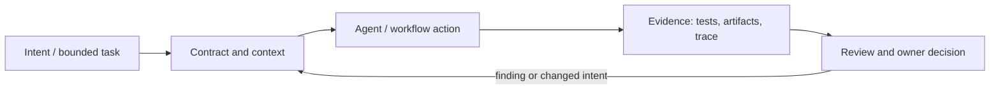

# Исследование Р4.20: Методология 6. superpowers

## Метаданные
- Исследование / проверка источников: 2026-11-02.
- Зависимости: Р4.15, Р4.08; базовое понятие субагента.
- Scope: technical concepts, alternatives, production constraints and a lesson plan; no lesson draft, product install, benchmark or executable run.
- Evidence policy: product documentation is primary for documented product behavior, not for independent effectiveness claims. “Expected” demonstration output is not observed output.

## Исследовательские вопросы и ответы
### 1. Who maintains Superpowers?

Jesse Vincent/Prime Radiant and open-source contributors, per repository; check pinned release for current structure. [SRC-407](sources.md#src-407)
### 2. What are core workflow stages described?

Brainstorming, worktrees, planning, subagent or inline execution, TDD, review and branch finish. [SRC-407](sources.md#src-407)
### 3. Are its skills guaranteed to run?

No. Activation depends on supported harness, descriptions/configuration and session; verify actual invocation. [SRC-407](sources.md#src-407)
### 4. Is TDD equivalently enforced in every IDE?

Not guaranteed by README; implementation relies on instructions/agent adherence unless external test gates enforce results. [SRC-407](sources.md#src-407)
### 5. Have setup, telemetry, license or skill evals been independently tested?

No; research inspected repo docs only. Inspect license, scripts, permissions and current release before production adoption. [SRC-407](sources.md#src-407)

## Определения, механизмы и границы
Superpowers is a community maintained agent-skills framework and self-described software-development methodology. Current repository describes brainstorming, worktree baseline, writing plans, subagent/manual execution, TDD, review and branch finish; harness installs and available features vary. Classify source claims and skill instructions, not as proven universal efficacy.

### Внутренняя модель
Trace skill selection/activation and bootstrap for target harness; map design approval → plan → execution route → review → finishing. Distinguish subagent-driven branch from inline executing-plan mode, and repository skill content from plugin installation/marketplace. Pin release and inspect scripts/hooks/telemetry.

Диаграмма — учебная абстракция. Она не заявляет, что конкретный продукт реализует все компоненты в таком порядке.

## Сравнение альтернатив
Матрица — качественный trade-off analysis, не benchmark. Для внедрения нужно согласовать risk weights и измерить на общей задаче.

| Alternative | Fit / trade-off | Adoption effort | Maintenance | Safety | Verifiability | Applicability |
|---|---|---|---|---|---|---|
| Manual checklist/skills | Portable ideas, human burden | Varies by project | Maintenance depends on ownership/versioning | Least privilege and audit required where side effects exist | Check against fixed acceptance oracle | Applicable only within stated scope |
| Superpowers guided skills | Rich flow, harness/activation dependency | Varies by project | Maintenance depends on ownership/versioning | Least privilege and audit required where side effects exist | Check against fixed acceptance oracle | Applicable only within stated scope |
| Custom org framework | Policy fit, owner and maintenance cost | Varies by project | Maintenance depends on ownership/versioning | Least privilege and audit required where side effects exist | Check against fixed acceptance oracle | Applicable only within stated scope |
| CI-only controls | Deterministic gates, no intent elicitation | Varies by project | Maintenance depends on ownership/versioning | Least privilege and audit required where side effects exist | Check against fixed acceptance oracle | Applicable only within stated scope |

## Разобранная авторская демонстрация
**Сценарий:** Show documentation-derived sequence for one small request, mark expected output and gate at each stage; illustrate that skills specify a workflow, but execution requires supported integration. No plugin was installed; no tests or triggers run.

**Статус:** спроектированный documentary walkthrough на Engineering Workbench; в этом исследовании запусков не было. Планируемые проверки/артефакты ниже — ожидаемые, не фактические результаты. В будущем уроке среду, версии, команды и фактический вывод указывать отдельно.

## Production engineering
Run permission review, privacy/telemetry check, baseline tests and external code review; track subagent coordination cost, TDD compliance, false activation, model and integration support. High ceremony may be inefficient for tiny tasks; task duration claims from README are anecdotal.

Общие контрольные вопросы для перехода в production: brownfield baseline и compatibility; ownership/approval; least privilege, secret handling and trust boundary; deterministic tests and CI; code review; audit/provenance; latency, tokens, license/access and review/rework cost; rollback/recovery; failure and upgrade behavior.

## Claims and evidence
| Утверждение | Уверенность | SRC-ID | Ограничения |
|---|---|---|---|
| Определение/механизм темы «Методология 6. superpowers». | Verified for cited sources / Interpretation where course-specific | SRC-407 | Не переносить продуктовые детали между harness; working definition прямо отмечена выше. |
| Значимые ограничения и production controls документированы у соответствующего первоисточника. | Verified guidance | SRC-407 | Рекомендации не доказывают итоговую эффективность и не являются результатом исполнения. |
| Сценарий Workbench можно показать в lesson. | Interpretation | — | Только спроектированный walkthrough; приложение/agent/workflow не запускались. |

## Неопределённости и работа до lesson draft
Pin Superpowers version and harness; inspect install mechanism, license, telemetry settings and current skills tests before reproducible walkthrough.

До подготовки урока перепроверить динамические страницы, выбрать harness/версии, сохранить доступные официальные документы и не исполнять непроверенные install-команды. Если практическая среда недоступна, оставить материал как документальный разбор.
