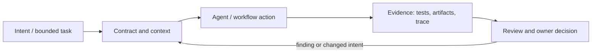

# Исследование Р4.21: Как читать и сравнивать методологии

## Метаданные
- Исследование / проверка источников: 2026-11-02.
- Зависимости: Р4.15–Р4.20, Р3.07.
- Scope: technical concepts, alternatives, production constraints and a lesson plan; no lesson draft, product install, benchmark or executable run.
- Evidence policy: product documentation is primary for documented product behavior, not for independent effectiveness claims. “Expected” demonstration output is not observed output.

## Исследовательские вопросы и ответы
### 1. Why compare on one case?

It controls task and oracle better than unrelated demos; still a single case limits generalization. [SRC-401](sources.md#src-401), [SRC-404](sources.md#src-404)
### 2. Which claims require live execution?

Install behavior, trigger support, generated files, actual workflow gates, compatibility and latency/quality outcomes. [SRC-401](sources.md#src-401), [SRC-404](sources.md#src-404)
### 3. How distinguish vendor documentation from independent measurement?

Label evidence source and method; docs describe intended capability, benchmark records observed outcomes with conditions. [SRC-401](sources.md#src-401), [SRC-404](sources.md#src-404)
### 4. What common criteria matter?

Intent/traceability, brownfield fit, verification, security, setup/maintenance, human effort, TCO, accessibility and failure recovery. [SRC-401](sources.md#src-401), [SRC-404](sources.md#src-404)
### 5. How should inaccessible products appear?

Mark document-only or not assessed; do not equate absent access with failure or docs with verified behavior. [SRC-401](sources.md#src-401), [SRC-404](sources.md#src-404)

## Определения, механизмы и границы
This is the synthesis lesson: compare defined workflow instances, not labels. The set is heterogeneous—open-source toolkits/frameworks, hosted IDE products and course working models—so first classify unit under comparison. No universal winner follows from feature tables or vendor marketing.

### Внутренняя модель
Create dossier: author/org, source and version/date, intended user, artifacts, state transitions, human gates, agent/runtime/tool support, installer/permissions, output persistence, checks, change reconciliation, price/access. For controlled case fix baseline commit, task, acceptance oracle, model/runtime as feasible, reviewer and timebox; record deviations and repeat where warranted.

Диаграмма — учебная абстракция. Она не заявляет, что конкретный продукт реализует все компоненты в таком порядке.

## Сравнение альтернатив
Матрица — качественный trade-off analysis, не benchmark. Для внедрения нужно согласовать risk weights и измерить на общей задаче.

| Alternative | Fit / trade-off | Adoption effort | Maintenance | Safety | Verifiability | Applicability |
|---|---|---|---|---|---|---|
| Documentation comparison | Cheap, only intended design | Varies by project | Maintenance depends on ownership/versioning | Least privilege and audit required where side effects exist | Check against fixed acceptance oracle | Applicable only within stated scope |
| Repository/source inspection | Implementation detail, misses usage context | Varies by project | Maintenance depends on ownership/versioning | Least privilege and audit required where side effects exist | Check against fixed acceptance oracle | Applicable only within stated scope |
| Controlled task study | Comparability, narrow external validity | Varies by project | Maintenance depends on ownership/versioning | Least privilege and audit required where side effects exist | Check against fixed acceptance oracle | Applicable only within stated scope |
| Production field deployment | Ecological behavior, expensive/confounded | Varies by project | Maintenance depends on ownership/versioning | Least privilege and audit required where side effects exist | Check against fixed acceptance oracle | Applicable only within stated scope |

## Разобранная авторская демонстрация
**Сценарий:** Use one Workbench requirement and common rubric; compare documentation only for all candidates first. Limit hands-on rows to approaches that can be installed/accessed and truly executed. Record each claim status (documented, observed, independently measured, unknown) and no fabricated ranking.

**Статус:** спроектированный documentary walkthrough на Engineering Workbench; в этом исследовании запусков не было. Планируемые проверки/артефакты ниже — ожидаемые, не фактические результаты. В будущем уроке среду, версии, команды и фактический вывод указывать отдельно.

## Production engineering
Report false-positive/negative check behavior, security/data, accessibility/platform availability, license, maintenance support, hidden human effort, cost and legacy fit. Do not conflate documented function with effectiveness or code correctness.

Общие контрольные вопросы для перехода в production: brownfield baseline и compatibility; ownership/approval; least privilege, secret handling and trust boundary; deterministic tests and CI; code review; audit/provenance; latency, tokens, license/access and review/rework cost; rollback/recovery; failure and upgrade behavior.

## Claims and evidence
| Утверждение | Уверенность | SRC-ID | Ограничения |
|---|---|---|---|
| Определение/механизм темы «Как читать и сравнивать методологии». | Verified for cited sources / Interpretation where course-specific | SRC-401, SRC-404, SRC-405, SRC-406, SRC-407, SRC-413 | Не переносить продуктовые детали между harness; working definition прямо отмечена выше. |
| Значимые ограничения и production controls документированы у соответствующего первоисточника. | Verified guidance | SRC-401, SRC-404, SRC-405, SRC-406, SRC-407, SRC-413 | Рекомендации не доказывают итоговую эффективность и не являются результатом исполнения. |
| Сценарий Workbench можно показать в lesson. | Interpretation | — | Только спроектированный walkthrough; приложение/agent/workflow не запускались. |

## Неопределённости и работа до lesson draft
Before comparative study, approve common case, freeze revisions/environment and plan sample/repeat count. Section 4 research itself performed only source-based review.

До подготовки урока перепроверить динамические страницы, выбрать harness/версии, сохранить доступные официальные документы и не исполнять непроверенные install-команды. Если практическая среда недоступна, оставить материал как документальный разбор.
